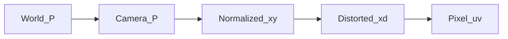

# 针孔相机成像、桶形/枕形畸变与图像去畸变

自学讲义。读完应能：画出针孔成像几何、用公式区分桶形与枕形、说清去畸变在工程上怎么做，并能对照本仓库 VINS-Mono 的针孔模型。

## 目录

1. [符号表](#1-符号表)
2. [坐标与成像流水线](#2-坐标与成像流水线)
3. [针孔成像（理想模型）](#3-针孔成像理想模型)
4. [为什么会有畸变](#4-为什么会有畸变)
5. [桶形与枕形：径向畸变](#5-桶形与枕形径向畸变)
6. [切向畸变与完整 Brown–Conrady 模型](#6-切向畸变与完整-brownconrady-模型)
7. [图像特点对照](#7-图像特点对照)
8. [去畸变怎么做](#8-去畸变怎么做)
9. [模型边界：何时不能再用针孔+Brown](#9-模型边界何时不能再用针孔brown)
10. [自测](#10-自测)
11. [自测参考答案](#11-自测参考答案)

---

## 1. 符号表

- $\mathbf{P}_w = (X_w, Y_w, Z_w)^\top$：世界坐标系下的三维点
- $\mathbf{P}_c = (X, Y, Z)^\top$：相机坐标系下的三维点（下文省略下标 $c$）
- $R, \mathbf{t}$：世界到相机的旋转与平移
- $(x, y)$：归一化平面（$Z=1$）上的**无畸变**坐标
- $(x_d, y_d)$：同一平面上的**畸变后**坐标
- $r^2 = x^2 + y^2$，有时也写成 $\rho^2$
- $(u, v)$：无畸变像素；$(u_d, v_d)$：传感器真正拍到的畸变像素
- $f_x, f_y$：以像素为单位的焦距；$c_x, c_y$：主点（光轴与像面交点的像素坐标）
- $k_1, k_2, k_3$：径向畸变系数；$p_1, p_2$：切向畸变系数

约定与 OpenCV / 本仓库一致：相机光心为原点，$Z$ 朝前，$X$ 向右，$Y$ 向下。只有 $Z > 0$ 的点才会落到相机前方。

---

## 2. 坐标与成像流水线

后面所有公式都挂在这四步上。理想针孔没有第三步；真实镜头在归一化平面上先畸变，再乘内参。



世界点到相机：

$$
\mathbf{P}_c = R \mathbf{P}_w + \mathbf{t}
$$

要求 $Z > 0$，否则点在相机后面，投影无物理意义。

工程含义：标定给的是「从无畸变归一化坐标到像素」以及「畸变多项式」；SLAM 里特征点先去畸变，再当针孔射线用。

---

## 3. 针孔成像（理想模型）

### 直觉

想象暗箱前面只有一个无穷小的孔（光心）。物体上一点发出的光线必须穿过这个孔才能打到后面的像平面。物点、光心、像点三点共线。用相似三角形：物体离光心越远（$Z$ 越大），像越小。

数字相机把「像平面」做成传感器网格。为了公式干净，通常不把像平面画在光心后面（倒立实像），而是画在光心前方 $Z=1$ 的**归一化平面**上：坐标只差一个符号，几何等价。

```
侧视（Y 省略，只看 X-Z）：

        物点 P (X, Z)
           \
            \     归一化平面 Z=1          像素平面
             \         |                      |
              \        |  (x, 1)              |  u = fx*x + cx
               \       | /                    |
                \      |/                     |
                 O 光心 ---------------------- 主点 (cx)
                /
               /  Z 朝前
```

焦距在物理上是光心到传感器的距离；写成 $f_x, f_y$ 后已经乘上了「每毫米多少像素」，并允许 $x$、$y$ 方向像素不是正方形。

### 公式

三维点投影到归一化平面：

$$
x = \frac{X}{Z},\qquad y = \frac{Y}{Z}
$$

再映射到像素（针孔内参矩阵 $K$）：

$$
\begin{bmatrix} u \\ v \\ 1 \end{bmatrix}
=
\begin{bmatrix}
f_x & 0 & c_x \\
0 & f_y & c_y \\
0 & 0 & 1
\end{bmatrix}
\begin{bmatrix} x \\ y \\ 1 \end{bmatrix}
$$

展开即：

$$
u = f_x\, x + c_x,\qquad v = f_y\, y + c_y
$$

若传感器阵列有轻微倾斜，会多一个 skew $\alpha$：

$$
u = f_x (x + \alpha y) + c_x,\qquad v = f_y\, y + c_y
$$

本仓库 VINS-Mono 针孔模型里 $\alpha = 0$。

反向（像素 → 射线）在无畸变时是闭式的：

$$
x = \frac{u - c_x}{f_x},\qquad y = \frac{v - c_y}{f_y}
$$

三维方向为 $(x, y, 1)^\top$，深度 $Z$ 从针孔本身无法恢复。

### 图像特点

- 空间中的直线，投影仍是直线（透视会汇聚到消失点，但不会弯）。
- 近大远小；平行线在像面上一般不平行。
- 主点附近和边缘服从同一套相似比，没有「中间鼓、四周缩」。
- 视场不能太大：边缘入射角很大时，薄透镜根本不是针孔，这一套会失效。

工程含义：视觉几何（对极、PnP、三角化）默认的就是这个模型。畸变必须先消掉，或在投影函数里显式加上，否则直线约束和重投影误差都会歪。

---

## 4. 为什么会有畸变

针孔没有透镜，进光量极小。真实相机用多组透镜把大视场、足够亮度的光收进小小的传感器。

透镜的放大率随视场角变化：离光轴越远，同一物高对应的像高不再严格正比于 $\tan\theta$。这种沿半径方向的拉伸/压缩就是**径向畸变**。

另外，透镜组光轴与传感器平面可能不完全垂直，安装也可能略偏心。像点会再被拽向一个与半径不完全共线的方向，这是**切向畸变**。

日常观感几乎总是径向主导；切向系数往往比 $k_1$ 小一到两个数量级。标定仍要把 $p_1, p_2$ 算上，否则棋盘格角落会留下系统偏差。

---

## 5. 桶形与枕形：径向畸变

畸变定义在**归一化平面**上，不要先乘 $f_x$ 再畸变（除非你用的是以像素半径写的另一套参数，OpenCV 标准接口不是那样）。

### 公式（Brown 径向项）

$$
r^2 = x^2 + y^2
$$

$$
x_d = x \bigl(1 + k_1 r^2 + k_2 r^4 + k_3 r^6\bigr)
$$

$$
y_d = y \bigl(1 + k_1 r^2 + k_2 r^4 + k_3 r^6\bigr)
$$

令径向放大因子

$$
L(r) = 1 + k_1 r^2 + k_2 r^4 + k_3 r^6
$$

则 $(x_d, y_d) = L(r)\,(x, y)$。方向不变，只沿半径缩放。主点处 $r=0$，$L=1$，**中心几乎不畸变**。

最后才进像素：

$$
u_d = f_x x_d + c_x,\qquad v_d = f_y y_d + c_y
$$

### 桶形（barrel）

- 典型条件：$k_1 < 0$ 为主（$L(r) < 1$ 且随 $r$ 减小）。
- 直觉：边缘放大率小于中心。同样一块物方网格，四周被「挤向中心」，画面像从鼓起的桶外表面看进去。
- 直线：弓背朝画面外（中段离中心更远）。
- 常见：广角镜头、手机主摄、车载相机。

```
理想棋盘格              桶形（k1 < 0）

+--+--+--+--+           .  +--+--+.
|  |  |  |  |            \ |  |  | /
+--+--+--+--+             +--+--+--+
|  |  |  |  |             |  |  |  |
+--+--+--+--+             +--+--+--+
|  |  |  |  |            / |  |  | \
+--+--+--+--+           '  +--+--+'
```

### 枕形（pincushion）

- 典型条件：$k_1 > 0$ 为主（$L(r) > 1$）。
- 直觉：边缘放大率大于中心。四周被「拉开」，画面像枕套从四个角被拽住。
- 直线：弓背朝画面内（中段更靠近中心）。
- 常见：长焦、部分变焦头的长焦端。

```
理想棋盘格              枕形（k1 > 0）

+--+--+--+--+            / +--+--+ \
|  |  |  |  |           +--+--+--+--+
+--+--+--+--+           |  |  |  |  |
|  |  |  |  |           +--+--+--+--+
+--+--+--+--+           |  |  |  |  |
|  |  |  |  |           +--+--+--+--+
+--+--+--+--+            \ +--+--+ /
```

### 高阶项与须状畸变

$k_2, k_3$ 只管更靠边缘的弯曲。若 $k_1$ 与 $k_2$ 异号，$L(r)$ 随半径先减后增（或相反），格子会先桶再枕，称为**须状 / 混合畸变（mustache）**。看图不能只看 $k_1$ 的符号，要以整条 $L(r)$ 曲线为准。

### 本仓库对照

VINS-Mono 针孔实现见 `VINS-Mono/camera_model/include/camodocal/camera_models/PinholeCamera.h`：用 $k_1, k_2$（没有 $k_3$）再加切向。

- `VINS-Mono/config/euroc/euroc_config.yaml`：`k1: -2.917e-01`（负）→ **桶形为主**，$k_2 = 8.228\times 10^{-2}$ 为正，边缘会有高阶回补。
- `VINS-Mono/config/realsense/realsense_color_config.yaml`：`k1: +9.26e-02`（正）→ **枕形倾向**，$k_2$ 为负，同样可能带一点混合。

工程含义：标定文件里先看 $k_1$ 的符号，就能预判广角鼓还是长焦收；写投影函数时必须用归一化 $r$，不要把像素坐标直接丢进多项式。

---

## 6. 切向畸变与完整 Brown–Conrady 模型

### 直觉

切向项让像点在圆周的切线方向再挪一点，棋盘格不再关于中心对称，四角可能一个更尖、一个更钝，整体像轻微的平行四边形/梯形拉扯。

### 公式

在归一化平面上，完整常用形式为：

$$
x_d = x L(r) + \bigl(2 p_1 x y + p_2(r^2 + 2 x^2)\bigr)
$$

$$
y_d = y L(r) + \bigl(p_1(r^2 + 2 y^2) + 2 p_2 x y\bigr)
$$

其中 $L(r) = 1 + k_1 r^2 + k_2 r^4 + k_3 r^6$。

VINS-Mono 与上式相同（无 $k_3$），代码里把归一化坐标叫 $u,v$，把 $\rho^2 = u^2+v^2$：

$$
L = 1 + k_1 \rho^2 + k_2 \rho^4
$$

$$
d_u = 2 p_1 u v + p_2(\rho^2 + 2 u^2)
$$

$$
d_v = p_1(\rho^2 + 2 v^2) + 2 p_2 u v
$$

$$
u' = L u + d_u,\qquad v' = L v + d_v
$$

$$
\text{像素：}\quad u_{\mathrm{pix}} = f_x u' + c_x,\qquad v_{\mathrm{pix}} = f_y v' + c_y
$$

（若启用 skew，则 $u_{\mathrm{pix}} = f_x(u' + \alpha v') + c_x$。）

图像特点：中心仍几乎不动；不对称、梯形感；单独看远不如桶/枕显眼。

工程含义：OpenCV `calibrateCamera` 默认就是这套系数顺序 $(k_1,k_2,p_1,p_2[,k_3])$。投影与去畸变必须用同一套，不能径向用 Brown、切向又换另一本书的符号。

---

## 7. 图像特点对照

（不用表格，便于纯文本阅读。）

**理想针孔**

- 直线：直
- 中心：与边缘同一套透视
- 边缘放大：均匀的透视缩放，无额外 $L(r)$
- 典型：教学模型；窄视场、已去畸变的图

**桶形（$k_1<0$ 为主）**

- 直线：弯，弓背朝外
- 中心：几乎不变
- 边缘放大：变小，景物被挤向中间
- 典型：广角、EuRoC 针孔配置

**枕形（$k_1>0$ 为主）**

- 直线：弯，弓背朝内
- 中心：几乎不变
- 边缘放大：变大，四角被拽出去
- 典型：长焦；本仓库 RealSense color 的 $k_1>0$

**切向（$p_1,p_2$）**

- 直线：可弯且不对称
- 中心：几乎不变
- 边缘放大：沿切向错位，不像单纯缩放
- 典型：装配公差；系数通常很小

**须状 / 混合**

- 直线：从中心向外先一种弯、再反一种弯
- 由 $k_1$ 与 $k_2,k_3$ 异号造成

---

## 8. 去畸变怎么做

观测到的永远是畸变像素 $(u_d, v_d)$。正向模型 $(x,y)\mapsto(x_d,y_d)$ 是多项式，**反向一般没有闭式解**。工程上分「点」和「整张图」两条路。

### 8.1 像素先回到畸变归一化平面

内参不参与弯曲，先除掉：

$$
x_d = \frac{u_d - c_x}{f_x},\qquad y_d = \frac{v_d - c_y}{f_y}
$$

接下来要求无畸变的 $(x,y)$，使得 Brown 正向作用后等于 $(x_d, y_d)$。

### 8.2 迭代求无畸变归一化坐标（特征点）

OpenCV `undistortPoints`、VINS `liftProjective` 一类做法：

1. 初值：$x \leftarrow x_d$，$y \leftarrow y_d$
2. 用当前 $(x,y)$ 算 $L$ 和切向增量 $(d_x, d_y)$
3. 更新，例如 $x \leftarrow (x_d - d_x)/L$，$y \leftarrow (y_d - d_y)/L$（实现细节因库而异，都是固定点迭代）
4. 重复若干次直到变化很小

得到 $(x,y)$ 后，若要「无畸变像素」（仍用旧内参）：

$$
u = f_x x + c_x,\qquad v = f_y y + c_y
$$

SLAM 更常用的是直接把 $(x,y,1)$ 当射线，不必先画出一张去畸变图。

### 8.3 整图去畸变：remap（反向采样）

不要对每个畸变像素「推」到新位置——会有空洞和撞车。正确做法是：**输出图每个理想像素，去畸变图上问「我该涂什么颜色」**。

```
输出（无畸变格子）              输入（相机原图，已畸变）

 (u, v) 理想像素
    |
    |  去掉 K → (x, y)
    |  正向 Brown → (xd, yd)
    |  乘 K → (ud, vd) 一般不是整数
    v
  在原图 (ud, vd) 双线性取值  ----remap---->
```

步骤：

1. 选定输出图尺寸和新内参 $K'$（可以仍是 $K$，也可以略改 $f$、主点，见下节）。
2. 对输出图每个整数像素 $(u', v')$：
   - $\,x = (u'-c_x')/f_x'$，$y = (v'-c_y')/f_y'$
   - 用**正向**畸变得到 $(x_d, y_d)$，再用**旧** $K$ 得到 $(u_d, v_d)$
   - $I_{\mathrm{out}}(u',v') = \mathrm{bilinear}(I_{\mathrm{in}}, u_d, v_d)$
3. 落在原图外的位置涂黑。

OpenCV：`initUndistortRectifyMap` + `remap`。查找表算一次即可，之后每帧只做采样。

### 8.4 新内参与黑边

去畸变后，原来弯进去的边缘会「展平」，有效视场和主点都会变。

- `cv::getOptimalNewCameraMatrix(..., alpha=0)`：裁掉黑边，边缘景物可能被切掉。
- `alpha=1`：尽量保留原图所有内容，四周会有黑边。

改了 $K'$ 以后，后续几何必须用 $K'$，不能继续用标定文件里的旧 $f_x, c_x$。

### 8.5 特征点去畸变 vs 整图去畸变

- **整图**：可视化、立体校正后的稠密匹配、要给「已经是针孔」的模块吃图像。代价是插值、裁切、算力。
- **只去畸变点**：VINS / ORB-SLAM 跟踪器常见路径。原图提取特征（角点在畸变图上），再 `undistortPoints`，后端当针孔用。省一次 warp，也避免插值把角点抹糊。

本仓库 `VINS-Mono/feature_tracker` 里有 `showUndistortion`，用于可视化；真正进估计器的是去畸变后的归一化坐标。

### 8.6 去畸变做不到什么

- 只改正**几何位置**，不能恢复透镜模糊、色差、渐晕丢掉的高频信息。
- 直线会变直；四角可能被裁掉或留黑边。
- 畸变模型若与镜头不符（鱼眼硬套 $k_1,k_2$），迭代可能不收敛或边缘仍然弯。

工程含义：记住「正向易、反向难、整图用 remap」。写代码时对输出像素做正向投影去原图取样，不要反向推像素。

---

## 9. 模型边界：何时不能再用针孔+Brown

针孔 + Brown–Conrady 适合中等视场（大约几十度到略超 90°，视标定残差而定）。视场再大，$r=\tan\theta$ 在边缘爆炸，多项式很难拟合。

大视场应改用**以入射角 $\theta$ 为自变量**的鱼眼模型，例如等距（equidistant）/ Kannala–Brandt：理想投影是 $\theta$ 的奇次多项式，而不是 $k_1 r^2$。桶/枕仍然能在图上看到「鼓」或「收」，但系数含义已经不是本节的 $k_1$。

本仓库对应实现：`VINS-Mono/camera_model/include/camodocal/camera_models/EquidistantCamera.h`。配置里 `model_type` 若不是 `PINHOLE`，不要套本文公式。

---

## 10. 自测

先自己写答案，再看下一节。

1. 针孔模型里，三维点 $(X,Y,Z)$ 的归一化坐标是什么？为什么必须 $Z>0$？
2. $k_1 < 0$ 为主时，更可能是桶形还是枕形？直线的弓背朝哪？
3. 为什么主点附近看起来几乎没有畸变？
4. 去畸变整张图时，应该「把畸变像素推到新位置」，还是「对理想像素到原图采样」？为什么？
5. EuRoC 的 `k1 ≈ -0.29` 和 RealSense color 的 `k1 ≈ +0.093`，各自偏向哪种径向畸变？
6. VINS 这类 SLAM 是否必须先 `remap` 出一张去畸变图才能做跟踪？
7. $k_1$ 与 $k_2$ 异号时，还能否只凭 $k_1$ 断定整幅图只有桶或只有枕？
8. 去畸变之后，能否继续使用标定文件里原来的 $f_x, c_x$ 而不加思考？

---

## 11. 自测参考答案

1. $x=X/Z$，$y=Y/Z$。$Z\le 0$ 表示点在相机平面上或后方，针孔射线不往那一侧成像。
2. 桶形；弓背朝画面外（中段离像中心更远）。
3. 径向因子是 $1 + k_1 r^2 + \cdots$，$r=0$ 时高阶全为 0，$L=1$。
4. 对理想像素做正向畸变，到原图双线性采样（remap）。正向推像素会造成空洞和多个源写同一目标。
5. EuRoC 桶形为主；RealSense color 枕形倾向（仍要看 $k_2$ 是否造成边缘回弯）。
6. 不必。可以对特征做 `undistortPoints` / `liftProjective`，后端用归一化坐标。
7. 不能。异号会出现须状/混合畸变，边缘形态随半径变化。
8. 不能一概而论。若 `getOptimalNewCameraMatrix` 或立体校正改了 $K'$，必须用新内参；若只对点去畸变且仍按原 $K$ 定义无畸变像素，才继续用原 $f_x,c_x$。

---

## 小结（可当卡片）

- 针孔：共线 + 相似比；$x=X/Z$，$u=f_x x+c_x$；直线仍直。
- 径向：$(x_d,y_d)=L(r)(x,y)$；$k_1<0$ 桶，$k_1>0$ 枕；中心几乎不动。
- 切向：Brown 的 $p_1,p_2$ 项；不对称拉扯，通常较小。
- 去畸变：正向多项式易算；反向靠迭代；整图必须 remap；SLAM 常常只修正点。
