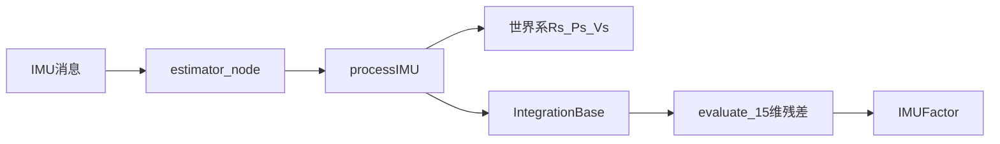
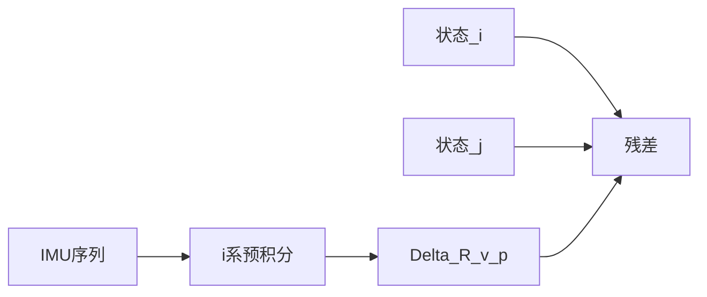

# IMU 与预积分：从零到 VINS-Mono

自学讲义。面向**有本科线代、微积分、概率与优化基础，但没有 IMU、没有 VIO 背景**的读者。本文以本仓库 [`VINS-Mono`](../../VINS-Mono/) 的数据流为骨架：从「IMU 是什么」推到 `IntegrationBase::evaluate` 的 15 维残差，**过程中间不跳步**。

若你已熟悉旋转矩阵的指数映射、右扰动，可并行阅读 [李群讲义](lie_groups.md)；若还不熟，§4.4 给出预积分所需的最小旋转工具，足够读 `processIMU` 与 `midPointIntegration`。

读完应能：

- 沿着 VINS 的调用链指出：一条 IMU 消息如何变成世界系传播、如何变成两帧之间的预积分量；
- 说明 IMU 两个传感器各自测什么、为什么不能把加计读数直接当「加速度」；
- 从牛顿定律推出 $\dot{\mathbf{v}}=R(\tilde{\mathbf{a}}-\mathbf{b}_a)-\mathbf{G}$，并从连续积分推出 $\Delta R,\Delta\mathbf{v},\Delta\mathbf{p}$；
- 手算一步中值预积分，写出 15 维残差，并对照 [`integration_base.h`](../../VINS-Mono/vins_estimator/src/factor/integration_base.h) 的 `evaluate`。

**本文正文不写**：`F`/`V` 逐块推导、Ceres 四个参数块雅可比、视觉–IMU 初始化、滑窗边缘化、外参与时间偏移 `td` 的估计（`td` 只在数据流里作为插值时刻出现一次）。需要时见文末附录与指针。

---

## 目录

**第 0 篇：地图**

0. [读本文之前](#0-读本文之前)
1. [VINS 里 IMU 走哪条路](#1-vins-里-imu-走哪条路)

**第一篇：IMU 基础**

2. [IMU 是什么](#2-imu-是什么)
3. [为什么 VIO 需要 IMU](#3-为什么-vio-需要-imu)
4. [坐标系、姿态与旋转工具](#4-坐标系姿态与旋转工具)
5. [陀螺仪](#5-陀螺仪)
6. [加速度计与比力](#6-加速度计与比力)
7. [Bias 与噪声模型](#7-bias-与噪声模型)
8. [连续时间运动学汇总](#8-连续时间运动学汇总)

**第二篇：两条积分（过程主线）**

9. [世界系中值：`processIMU`](#9-世界系中值processimu)
10. [世界系积分为何不能直接当 BA 因子](#10-世界系积分为何不能直接当-ba-因子)
11. [预积分的思想](#11-预积分的思想)
12. [从世界系积分推出相对量](#12-从世界系积分推出相对量)
13. [相对量的 ODE 与状态恒等式](#13-相对量的-ode-与状态恒等式)
14. [离散预积分与对照表](#14-离散预积分与对照表)
15. [两拍 IMU 手算](#15-两拍-imu-手算)
16. [Bias 的一阶修正](#16-bias-的一阶修正)
17. [15 维预积分残差](#17-15-维预积分残差)

**第三篇：接到优化**

18. [`IMUFactor`：接到滑窗](#18-imufactor接到滑窗)
19. [文件地图、读码顺序与 Forster 符号](#19-文件地图读码顺序与-forster-符号)
20. [掌握清单](#20-掌握清单)
21. [自测与参考答案](#21-自测与参考答案)

**附录（不要求手推）**

- [A. `F` 与 `V` 在代码里做什么](#附录-a-f-与-v-在代码里做什么)
- [B. `imu_factor.h` 四个雅可比矩阵](#附录-b-imu_factorh-四个雅可比矩阵)

---

# 第 0 篇：地图

## 0. 读本文之前

你需要会：

- **向量与矩阵**：点积、叉积 $\mathbf{a}\times\mathbf{b}$、矩阵乘向量。
- **微积分**：导数、常微分方程、定积分 $\int_{t_i}^{t_j}f(\tau)\,d\tau$。
- **概率（后面用）**：多元高斯、协方差；知道「白噪声」「随机游走」是**建模假设**即可（§7 会定义）。

不需要：控制理论、Kalman 滤波、李群公理化。

---

## 1. VINS 里 IMU 走哪条路

先看整条链，再回头填公式。VINS-Mono 里**每一条** IMU 消息几乎都走同一条路：



逐步对应代码。

**（1）对齐到图像时刻，再调用 `processIMU`。**  
[`estimator_node.cpp`](../../VINS-Mono/vins_estimator/src/estimator_node.cpp) 的 `process()` 把两次图像之间的 IMU 按时间排好。图像时刻取 $t_{\mathrm{img}}+\texttt{td}$（`td` 是相机–IMU 时间偏移，本文当已知常数）。若某条 IMU 刚好落在图像时刻之后，就在图像时刻做一次**线性插值**，再调用

```cpp
estimator.processIMU(dt, Vector3d(dx, dy, dz), Vector3d(rx, ry, rz));
```

**（2）`processIMU` 同时做两件不同的事。**  
[`estimator.cpp`](../../VINS-Mono/vins_estimator/src/estimator.cpp) 约 84–118 行：

- 把 `(dt, acc, gyr)` `push_back` 进当前帧的 `IntegrationBase`（**预积分**，在第 $i$ 帧 IMU 系里累积，**不减重力**）；
- 用**同一套中值公式**更新 `Rs[j], Ps[j], Vs[j]`（**世界系传播**，**要减重力**），给前端预测下一帧姿态。

这是全文最重要的工程事实：**同一段 IMU，积两遍，参考系不同。**

**（3）滑窗优化时，预积分变成一条因子。**  
相邻图像帧 $i,j$ 各有一组状态。`IntegrationBase::evaluate` 用两端状态与预积分量算出 15 维残差；[`estimator.cpp`](../../VINS-Mono/vins_estimator/src/estimator.cpp) 约 711–718 行把它挂进 Ceres：

```cpp
IMUFactor* imu_factor = new IMUFactor(pre_integrations[j]);
problem.AddResidualBlock(imu_factor, NULL,
    para_Pose[i], para_SpeedBias[i], para_Pose[j], para_SpeedBias[j]);
```

后文 §2–§8 解释 IMU 在测什么；§9–§17 把上面第（2）（3）步的公式从牛顿定律推出来；§18 把残差接到优化，但不手推雅可比。

---

# 第一篇：IMU 基础

## 2. IMU 是什么

**IMU**（Inertial Measurement Unit，惯性测量单元）通常指一块小芯片或模组，上面至少有两个传感器：

| 传感器 | 英文 | 测什么（直觉） | 典型单位 |
| --- | --- | --- | --- |
| 陀螺仪 | Gyroscope | 转得多快、绕哪根轴转 | rad/s |
| 加速度计 | Accelerometer | 机体感受到的「推力」/比力 | m/s² |

二者都固连在**机体**（无人机、手机、相机支架）上，输出是**机体坐标系**里的三维向量，采样频率常见 $100\sim 400\,\mathrm{Hz}$，远高于相机（约 $10\sim 30\,\mathrm{Hz}$）。

VINS-Mono 里每一帧图像对应一个时刻的位姿；两帧图像之间会收到**很多条** IMU 数据。预积分要回答的问题是：**怎样把这许多条 IMU 收成一条只连接两帧位姿的约束？**

---

## 3. 为什么 VIO 需要 IMU

单目相机：

- **尺度不可观**：从图像只能恢复轨迹的「形状」，整体放大缩小不影响重投影。
- **低频、运动模糊**：快速转头时，相邻帧间隔大，纯视觉跟踪容易丢。

IMU 提供：

- **高频**角速度与比力，短时约束旋转与加速度；
- 与重力方向结合后，可恢复**米制尺度**与重力对齐（初始化阶段，本文不展开）。

因此视觉惯性里程计（VIO）把相机（稀疏特征、重投影）与 IMU（预积分因子）放在**同一个优化问题**里估计位姿、速度、bias。

---

## 4. 坐标系、姿态与旋转工具

### 4.1 世界系 $w$ 与 IMU 系 $b$

- **世界系** $w$：固定不动的参考系。VINS 初始化后，$z$ 轴大致朝上，重力相关向量写为 $\mathbf{G}\approx(0,0,9.8)^\top$（单位 m/s²，见 `parameters.cpp` 的 `G{0.0, 0.0, 9.8}`）。
- **IMU 系** $b$：原点在 IMU 中心，固连在机体上，随机体一起转、一起平移。

记 $t$ 时刻 IMU 原点在世界系的位置为 $\mathbf{p}(t)\in\mathbb{R}^3$，速度 $\mathbf{v}(t)=\dot{\mathbf{p}}(t)\in\mathbb{R}^3$。

### 4.2 旋转矩阵 $R(t)$

$R(t)\in\mathbb{R}^{3\times 3}$ 描述 $t$ 时刻 IMU 系相对世界系的**姿态**。VINS 约定：

$$
\mathbf{x}_w = R\,\mathbf{x}_b.
$$

即：把写在 IMU 系里的向量 $\mathbf{x}_b$ 变到世界系 $\mathbf{x}_w$。$R$ 正交：$R^\top R=I$，$\det R=1$。

代码里 `Rs[i]` 就是 $R_i$；四元数 `Qs[i]` 与 $R_i$ 一一对应（差一个符号 $\pm q$）。

### 4.3 叉积与反对称矩阵 $[\mathbf{u}]_\times$

对 $\mathbf{u},\mathbf{v}\in\mathbb{R}^3$，

$$
[\mathbf{u}]_\times=
\begin{pmatrix}
0 & -u_3 & u_2 \\
u_3 & 0 & -u_1 \\
-u_2 & u_1 & 0
\end{pmatrix},
\qquad
[\mathbf{u}]_\times\mathbf{v}=\mathbf{u}\times\mathbf{v}.
$$

代码 `Utility::skewSymmetric` 就是这个矩阵。后文陀螺、旋转微分方程里会反复出现 $[\boldsymbol{\omega}]_\times$。

### 4.4 小角度旋转与四元数（预积分够用版）

角速度 $\boldsymbol{\omega}$ 在很短时间 $\delta t$ 内产生的旋转，可近似为

$$
R(t+\delta t)\approx R(t)\,\exp\bigl([\boldsymbol{\omega}\,\delta t]_\times\bigr),
\qquad
\exp([\boldsymbol{\phi}]_\times)\approx I+[\boldsymbol{\phi}]_\times
\quad(\|\boldsymbol{\phi}\|\ll 1).
$$

**四元数** $q=(w,x,y,z)$ 与旋转等价。小角度时

$$
\delta q \approx \Bigl(1,\,\tfrac12\phi_1,\,\tfrac12\phi_2,\,\tfrac12\phi_3\Bigr),
\quad \boldsymbol{\phi}=\boldsymbol{\omega}\,\delta t.
$$

VINS `Utility::deltaQ(theta)` 正是设 $w=1$、向量部 $=\boldsymbol{\theta}/2$。预积分里

```cpp
result_delta_q = delta_q * Quaterniond(1, un_gyr(0)*dt/2, ...);
```

表示 $\Delta q\leftarrow \Delta q\otimes \delta q(\boldsymbol{\omega}\delta t)$（右乘增量）。更完整的 Rodrigues 公式见 [李群讲义 §5](lie_groups.md)。

### 4.5 本文核心符号表

| 符号 | 含义 |
| --- | --- |
| $\mathbf{p},\mathbf{v}$ | IMU 原点在世界系的位置、速度 |
| $R$ | IMU 系 → 世界系旋转 |
| $\boldsymbol{\omega}^b$ | 角速度，**写在 IMU 系** |
| $\tilde{\boldsymbol{\omega}},\tilde{\mathbf{a}}$ | 陀螺、加计**原始读数**（IMU 系） |
| $\mathbf{b}_g,\mathbf{b}_a$ | 陀螺、加计 **bias** |
| $\mathbf{G}$ | VINS 重力向量 $(0,0,9.8)^\top$，世界系 $z$ 朝上 |
| $\Delta t=t_j-t_i$ | 两**图像帧**间隔（代码 `sum_dt`） |
| $\delta t$ | 相邻两次 IMU 采样间隔（代码 `_dt`） |
| $\Delta R,\Delta\mathbf{v},\Delta\mathbf{p}$ | 预积分量（代码 `delta_q, delta_v, delta_p`） |

忽略地球自转；世界系当作**惯性系**（牛顿定律成立）。

---

## 5. 陀螺仪

### 5.1 物理上测什么

陀螺仪测量 IMU 相对惯性系（世界系）的**瞬时角速度**，但输出写在**机体（IMU）系**里，记 $\boldsymbol{\omega}^b(t)$。

若机体绕 IMU 的 $x$ 轴以 $0.1\,\mathrm{rad/s}$ 转动，则 $\boldsymbol{\omega}^b\approx(0.1,0,0)^\top$（与轴定义一致）。

### 5.2 测量方程（含 bias 与噪声）

真实芯片有零偏和噪声。工程上写：

$$
\tilde{\boldsymbol{\omega}}(t)=\boldsymbol{\omega}^b(t)+\mathbf{b}_g(t)+\mathbf{n}_g(t).
$$

- $\mathbf{b}_g$：**bias**，缓慢变化，同一秒内近似常数。
- $\mathbf{n}_g$：**白噪声**，每次采样独立、均值为 0（§7 定义）。

**反解**（名义积分时先令 $\mathbf{n}_g=0$）：

$$
\boldsymbol{\omega}^b(t)=\tilde{\boldsymbol{\omega}}(t)-\mathbf{b}_g(t).
$$

VINS 配置 `gyr_n` 是 $\mathbf{n}_g$ 的标准差量级；`gyr_w` 是 bias 随机游走强度。

### 5.3 角速度如何改变姿态

固定 IMU 系里某向量 $\mathbf{x}^b$（不随时间变）。世界系里 $\mathbf{x}^w(t)=R(t)\mathbf{x}^b$，求导：

$$
\dot{\mathbf{x}}^w=\dot R\,\mathbf{x}^b.
$$

刚体角速度满足 $\dot{\mathbf{x}}^w=\boldsymbol{\omega}^w\times\mathbf{x}^w$，且 $\boldsymbol{\omega}^w=R\boldsymbol{\omega}^b$，故

$$
\dot{\mathbf{x}}^w
=R\boldsymbol{\omega}^b\times(R\mathbf{x}^b)
=R[\boldsymbol{\omega}^b]_\times\mathbf{x}^b.
$$

（第二步用了 $R\mathbf{a}\times R\mathbf{b}=R(\mathbf{a}\times\mathbf{b})$，即旋转保持叉积。）$\mathbf{x}^b$ 任意，得**姿态微分方程**：

$$
\boxed{\dot R=R[\boldsymbol{\omega}^b]_\times}.
$$

这是后文所有旋转积分的起点。离散一步：若 $\boldsymbol{\omega}^b$ 在 $\delta t$ 内近似常数，则

$$
R(t+\delta t)=R(t)\,\exp\bigl([\boldsymbol{\omega}^b\delta t]_\times\bigr)
\approx R(t)\cdot\delta q(\boldsymbol{\omega}^b\delta t).
$$

---

## 6. 加速度计与比力

这是最容易误解的部分：**加计读数不是世界系加速度 $\dot{\mathbf{v}}$**。

### 6.1 牛顿第二定律（世界系 / 惯性系）

设 IMU 质心在世界系的速度 $\mathbf{v}(t)$，加速度 $\dot{\mathbf{v}}(t)$。质点受两类加速度来源：

1. **万有引力**：近似常向量，大小 $g_0\approx 9.8\,\mathrm{m/s^2}$，方向**指向地心**。记 $\mathbf{g}_{\downarrow}$。
2. **非引力外力**（电机推力、桌面支持力、手拿着的力等）：记单位质量下的力为 $\mathbf{f}^w$（比力，specific force，单位 m/s²）。

牛顿第二定律：

$$
\dot{\mathbf{v}}=\mathbf{f}^w+\mathbf{g}_{\downarrow}.
$$

例如自由落体：只有引力，$\mathbf{f}^w=\mathbf{0}$，故 $\dot{\mathbf{v}}=\mathbf{g}_{\downarrow}$（向下加速）。

### 6.2 加速度计测的是比力（在 IMU 系）

加速度计内部是检验质量 + 弹簧，测的是「支撑力」造成的加速度，**测不到引力**。它输出的是比力在 IMU 系下的分量：

$$
\tilde{\mathbf{a}}_{\text{真实}}
=R(t)^\top\mathbf{f}^w(t)+\text{bias}+\text{noise}.
$$

由 $\mathbf{f}^w=\dot{\mathbf{v}}-\mathbf{g}_{\downarrow}$ 得世界系关系，再转到 IMU 系（见 §6.4）。

### 6.3 两个具体例子（必做心算）

取世界系 $z$ **朝上**，$\mathbf{g}_{\downarrow}=(0,0,-9.8)^\top$。

**例 A：静放在桌面**

- 真实运动：$\dot{\mathbf{v}}=\mathbf{0}$。
- 比力：$\mathbf{f}^w=\dot{\mathbf{v}}-\mathbf{g}_{\downarrow}=\mathbf{0}-(0,0,-9.8)=(0,0,+9.8)$。桌面给向上的支持力。
- IMU 水平放置 $R=I$：$\tilde{\mathbf{a}}\approx(0,0,9.8)$。

**例 B：自由落体**

- $\dot{\mathbf{v}}=\mathbf{g}_{\downarrow}$，$\mathbf{f}^w=\mathbf{0}$。
- 加计读数 $\tilde{\mathbf{a}}\approx\mathbf{0}$（失重）。

所以：**静止时加计非零；自由落体时加计为零。** 这与「加速度计测加速度」的日常说法矛盾——日常说法省略了引力。

### 6.4 VINS 的 $\mathbf{G}$ 与测量方程

VINS 定义（`parameters.cpp` 里 `G{0.0, 0.0, 9.8}`）：

$$
\mathbf{G}:=-\mathbf{g}_{\downarrow}=(0,0,9.8)^\top.
$$

则 $\mathbf{f}^w=\dot{\mathbf{v}}+\mathbf{G}$。加计（加 bias $\mathbf{b}_a$、白噪声 $\mathbf{n}_a$）：

$$
\tilde{\mathbf{a}}
=R^\top\mathbf{f}^w+\mathbf{b}_a+\mathbf{n}_a
=R^\top(\dot{\mathbf{v}}+\mathbf{G})+\mathbf{b}_a+\mathbf{n}_a.
$$

**反解世界系加速度**（名义 $\mathbf{n}_a=0$）：

$$
\boxed{\dot{\mathbf{v}}=R(\tilde{\mathbf{a}}-\mathbf{b}_a)-\mathbf{G}}.
$$

逐步：$\tilde{\mathbf{a}}-\mathbf{b}_a=R^\top(\dot{\mathbf{v}}+\mathbf{G})$，左乘 $R$，再减 $\mathbf{G}$。

`processIMU` 里：

```cpp
un_acc = Rs[j] * (acc - Bas[j]) - g;   // g 即 G
```

**记忆口诀**：加计读数 → 减 bias → 乘 $R$ 到世界系 → **再减** $\mathbf{G}$，才是 $\dot{\mathbf{v}}$。

### 6.5 平动与位置

位置就是速度的积分：

$$
\boxed{\dot{\mathbf{p}}=\mathbf{v}}.
$$

---

## 7. Bias 与噪声模型

### 7.1 Bias 是什么

真实 MEMS 芯片有**零偏**：即使不动，陀螺也可能输出 $(0.01,0,0)$ 而非 $(0,0,0)$。若把读数直接当角速度，积分会**虚假旋转**。

**加计 bias** 同理：静止时应读 $(0,0,9.8)$，若读 $(0.1,0,9.8)$，多出的 $(0.1,0,0)$ 会被当成水平加速度，速度会漂。

VIO 把 $\mathbf{b}_g,\mathbf{b}_a$ 当作**优化状态**一起估计，而不是假设永远为零。

### 7.2 随机游走（bias 随时间慢变）

bias 不是每拍跳变的白噪声，而是**缓慢漂移**。常用连续模型：

$$
\dot{\mathbf{b}}_a=\mathbf{n}_{ba},\qquad \dot{\mathbf{b}}_g=\mathbf{n}_{bg},
$$

$\mathbf{n}_{ba},\mathbf{n}_{bg}$ 是零均值白噪声，强度由 `acc_w`、`gyr_w` 描述。

离散直观：$\mathbf{b}_{k+1}=\mathbf{b}_k+\text{小随机步}$。两帧图像之间 bias 变化小，预积分时**先当常数**积一遍；优化后 bias 变了，用 §16 的一阶修正。

VINS 还在残差里加 $\mathbf{b}_{a_j}-\mathbf{b}_{a_i}$、$\mathbf{b}_{g_j}-\mathbf{b}_{g_i}$，表示相邻帧 bias 应接近。

### 7.3 白噪声（测量毛刺）

**白噪声** $\mathbf{n}_g,\mathbf{n}_a$：每次采样独立、均值为 0、方差 $\sigma^2$（`gyr_n`、`acc_n`）。积分后误差会累积，但不会像 bias 那样变成**系统性**漂移。

| | 白噪声 | Bias |
| --- | --- | --- |
| 外观 | 高频抖动 | 慢漂移 |
| 积分效果 | 随机 walk，$\propto\sqrt{t}$ | 近似线性积累 |
| 优化 | 进协方差 $P$ | 当状态估计 |

这些都是**建模**，不是芯片手册里的物理定律；选这个模型是因为算起来方便且够用。

---

## 8. 连续时间运动学汇总

忽略 $\mathbf{n}_g,\mathbf{n}_a$，bias 在短区间上为常数。三条方程：

$$
\begin{aligned}
\dot R &= R[\tilde{\boldsymbol{\omega}}-\mathbf{b}_g]_\times, \\
\dot{\mathbf{v}} &= R(\tilde{\mathbf{a}}-\mathbf{b}_a)-\mathbf{G}, \\
\dot{\mathbf{p}} &= \mathbf{v}.
\end{aligned}
$$

记 $\boldsymbol{\omega}^b=\tilde{\boldsymbol{\omega}}-\mathbf{b}_g$，$\mathbf{a}^b=\tilde{\mathbf{a}}-\mathbf{b}_a$（IMU 系下的「去 bias 读数」）：

$$
\dot R=R[\boldsymbol{\omega}^b]_\times,\quad
\dot{\mathbf{v}}=R\mathbf{a}^b-\mathbf{G},\quad
\dot{\mathbf{p}}=\mathbf{v}.
$$

给定 $t_i$ 时刻的 $(R_i,\mathbf{v}_i,\mathbf{p}_i)$ 和 $[t_i,t_j]$ 上全部 IMU 读数，数值积分可得到 $t_j$ 的 $(R_j,\mathbf{v}_j,\mathbf{p}_j)$。下一节先在**世界系**里做离散积分（VINS 前端 `processIMU`），再讲为何后端要用**预积分**。

---

# 第二篇：两条积分（过程主线）

## 9. 世界系中值：`processIMU`

IMU 离散采样：$t_k,t_{k+1}$，$\delta t=t_{k+1}-t_k$。世界系传播（**含** $\mathbf{G}$）用**中值法**（精度比欧拉高）。这就是 §1 里「两件事」的第一件。

### 9.1 一步中值（与 `processIMU` 一致）

已知步初 $R,\mathbf{v},\mathbf{p}$，步内读数 $(\tilde{\boldsymbol{\omega}}_k,\tilde{\mathbf{a}}_k)$、$(\tilde{\boldsymbol{\omega}}_{k+1},\tilde{\mathbf{a}}_{k+1})$，bias $(\mathbf{b}_g,\mathbf{b}_a)$。代码里 `j = frame_count`，`Rs[j], Vs[j], Ps[j], Bas[j], Bgs[j]` 就是这些量；`acc_0` / `gyr_0` 是步初读数，当前函数参数是步末读数。

**Step 1 — 用步初 $R$ 算始端世界加速度**

$$
\mathbf{a}^w_0=R(\tilde{\mathbf{a}}_k-\mathbf{b}_a)-\mathbf{G}.
$$

```cpp
Vector3d un_acc_0 = Rs[j] * (acc_0 - Bas[j]) - g;
```

**为何减 `g`：** 由 §6.4，$\dot{\mathbf{v}}=R\mathbf{a}^b-\mathbf{G}$。这里要积的是真实世界系加速度。

**Step 2 — 平均角速度，更新旋转**

$$
\hat{\boldsymbol{\omega}}=\tfrac12(\tilde{\boldsymbol{\omega}}_k+\tilde{\boldsymbol{\omega}}_{k+1})-\mathbf{b}_g,
\qquad
R' = R\,\exp\bigl([\hat{\boldsymbol{\omega}}]_\times\delta t\bigr)
\approx R\cdot \delta q(\hat{\boldsymbol{\omega}}\delta t).
$$

```cpp
Vector3d un_gyr = 0.5 * (gyr_0 + angular_velocity) - Bgs[j];
Rs[j] *= Utility::deltaQ(un_gyr * dt).toRotationMatrix();
```

**Step 3 — 用更新后的 $R'$ 算末端世界加速度**

$$
\mathbf{a}^w_1=R'(\tilde{\mathbf{a}}_{k+1}-\mathbf{b}_a)-\mathbf{G}.
$$

```cpp
Vector3d un_acc_1 = Rs[j] * (linear_acceleration - Bas[j]) - g;
```

**Step 4 — 梯形平均加速度，更新速度与位置**

$$
\hat{\mathbf{a}}^w=\tfrac12(\mathbf{a}^w_0+\mathbf{a}^w_1),
\qquad
\mathbf{p}'=\mathbf{p}+\mathbf{v}\,\delta t+\tfrac12\hat{\mathbf{a}}^w\,\delta t^2,
\qquad
\mathbf{v}'=\mathbf{v}+\hat{\mathbf{a}}^w\,\delta t.
$$

```cpp
Vector3d un_acc = 0.5 * (un_acc_0 + un_acc_1);
Ps[j] += dt * Vs[j] + 0.5 * dt * dt * un_acc;
Vs[j] += dt * un_acc;
```

注意：$\mathbf{p}'$ 用的是步初 $\mathbf{v}$（中值法标准写法，与 VINS 一致）。

### 9.2 从连续方程到上式（不跳步）

连续：$\dot{\mathbf{v}}=\mathbf{a}^w(\tau)$。在 $[t_k,t_{k+1}]$ 上若 $\mathbf{a}^w$ 线性变化，梯形公式

$$
\mathbf{v}_{k+1}=\mathbf{v}_k+\tfrac12(\mathbf{a}^w_k+\mathbf{a}^w_{k+1})\delta t.
$$

$\mathbf{a}^w_k=R_k\mathbf{a}^b_k-\mathbf{G}$，但 $R$ 在区间内也在变：始端用 $R_k$，末端用 $R_k\exp([\hat{\boldsymbol{\omega}}]\delta t)$，再平均——即 Step 1–4。

旋转：$\dot R=R[\boldsymbol{\omega}]_\times$ 在 $\boldsymbol{\omega}\approx\hat{\boldsymbol{\omega}}$ 常数时，$R_{k+1}=R_k\exp([\hat{\boldsymbol{\omega}}]\delta t)$。

位置：$\dot{\mathbf{p}}=\mathbf{v}$，且 $\mathbf{v}(\tau)\approx\mathbf{v}_k+\hat{\mathbf{a}}^w(\tau-t_k)$，积分得

$$
\mathbf{p}_{k+1}=\mathbf{p}_k+\mathbf{v}_k\delta t+\tfrac12\hat{\mathbf{a}}^w\delta t^2.
$$

世界系这条链给前端一个「当前位姿」；它**还不是**优化里的 IMU 因子。原因见下一节。

---

## 10. 世界系积分为何不能直接当 BA 因子

Bundle Adjustment 的变量是**图像时刻**的 $\mathbf{x}_i=(\mathbf{p}_i,R_i,\mathbf{v}_i,\mathbf{b}_i)$。两帧 $i,j$ 之间有 $N$ 条 IMU（$N\sim 50$）。

若在因子里写：「从 $\mathbf{x}_i$ 出发，用世界系中值积 $N$ 步，应得到 $\mathbf{x}_j$」，则：

1. 每一步 $\mathbf{a}^w=R(\tau)(\tilde{\mathbf{a}}-\mathbf{b}_a)-\mathbf{G}$ 依赖 $R(\tau)$，而 $R(\tau)$ 从 $R_i$ 积出来。
2. 优化迭代改 $R_i$ 时，**整段 $N$ 步必须重算**。
3. 残差对 $R_i$ 的雅可比要穿过 $N$ 步积分链，无法预计算。

**预积分**的目标：把 $N$ 步 IMU 预先合并成三个量 $(\Delta R,\Delta\mathbf{v},\Delta\mathbf{p})$，它们**不含** $R_i,\mathbf{p}_i,\mathbf{v}_i$；只在最后与两端状态做**代数比较**。这就是 §1 里「两件事」的第二件。

---

## 11. 预积分的思想

固定**参考时刻** $t_i$，在 **IMU 系 $i$**（与 $R_i$ 对齐、但原点随 IMU 平移的系）里累积相对运动：

- $\Delta R_{ij}$：从 $i$ 到 $j$，相对旋转；
- $\Delta\mathbf{v}_{ij}$：在 $i$ 系里看到的、由比力引起的速度增量（**不含** $\mathbf{G}$）；
- $\Delta\mathbf{p}_{ij}$：在 $i$ 系里对应的位移增量。

优化时检查：由 $(\mathbf{p}_i,R_i,\mathbf{v}_i)$ 和 $(\mathbf{p}_j,R_j,\mathbf{v}_j)$ 按**运动学**算出的相对量，是否与 IMU 积出的 $(\Delta R,\Delta\mathbf{v},\Delta\mathbf{p})$ 一致。



关键区别（后文会反复用）：

- 世界系积分要减 $\mathbf{G}$，因为积的是 $\dot{\mathbf{v}}$；
- 预积分在 $i$ 系只积 $\Delta R\mathbf{a}^b$，**不减** $\mathbf{G}$；重力出现在两端状态的代数关系里。

---

## 12. 从世界系积分推出相对量

设 $\Delta t=t_j-t_i$。以下在**无噪声、bias 正确**下推导；bias 误差 §16 处理。

### 12.1 相对旋转

定义

$$
\Delta R_{ij}:=R_i^\top R_j.
$$

物理含义：$R_j=R_i\Delta R_{ij}$，即「先施加相对旋转 $\Delta R_{ij}$，再转到世界系」。

由 $\dot R=R[\boldsymbol{\omega}^b]_\times$，令 $R(\tau)=R_i\Delta R(\tau)$，$\Delta R(t_i)=I$。代入：

$$
R_i\Delta\dot R=R_i\Delta R[\boldsymbol{\omega}^b]_\times
\Rightarrow
\boxed{\Delta\dot R=\Delta R[\boldsymbol{\omega}^b]_\times},\quad \Delta R(t_i)=I.
$$

（$R_i$ 对 $\tau$ 为常数，可从两边约掉。）解为沿时间右乘小旋转（见 §4.4）。$\Delta R_{ij}=\Delta R(t_j)$ **只依赖** IMU 角速度序列，**不依赖** $R_i$ 的数值。

### 12.2 相对速度

对世界系 $\dot{\mathbf{v}}=R\mathbf{a}^b-\mathbf{G}$ 从 $t_i$ 积到 $t_j$：

$$
\mathbf{v}_j-\mathbf{v}_i
=\int_{t_i}^{t_j}R(\tau)\mathbf{a}^b(\tau)\,d\tau
-\mathbf{G}\Delta t.
$$

代入 $R(\tau)=R_i\Delta R(\tau)$，$R_i$ 提出积分号：

$$
\mathbf{v}_j=\mathbf{v}_i-\mathbf{G}\Delta t+R_i\int_{t_i}^{t_j}\Delta R(\tau)\mathbf{a}^b(\tau)\,d\tau.
$$

定义

$$
\boxed{
\Delta\mathbf{v}_{ij}
:=\int_{t_i}^{t_j}\Delta R(\tau)\mathbf{a}^b(\tau)\,d\tau
},\quad \Delta\mathbf{v}(t_i)=\mathbf{0}.
$$

则

$$
\mathbf{v}_j=\mathbf{v}_i-\mathbf{G}\Delta t+R_i\Delta\mathbf{v}_{ij}. \tag{V}
$$

$\Delta\mathbf{v}_{ij}$ 的积分核里只有 $\Delta R\mathbf{a}^b$，**没有** $\mathbf{G}$。重力是世界系常向量，已经单独积成 $-\mathbf{G}\Delta t$。

### 12.3 相对位置

$\dot{\mathbf{p}}=\mathbf{v}$，从 $t_i$ 积到 $t_j$：

$$
\mathbf{p}_j-\mathbf{p}_i=\int_{t_i}^{t_j}\mathbf{v}(\tau)\,d\tau.
$$

对任意 $\tau\in[t_i,t_j]$，把 (V) 写在 $[t_i,\tau]$（$\Delta t\to\tau-t_i$）：

$$
\mathbf{v}(\tau)=\mathbf{v}_i-\mathbf{G}(\tau-t_i)+R_i\Delta\mathbf{v}(\tau),
$$

其中 $\Delta\mathbf{v}(\tau)=\int_{t_i}^{\tau}\Delta R(s)\mathbf{a}^b(s)\,ds$。代入：

$$
\begin{aligned}
\mathbf{p}_j-\mathbf{p}_i
&=\int_{t_i}^{t_j}\Bigl(\mathbf{v}_i-\mathbf{G}(\tau-t_i)+R_i\Delta\mathbf{v}(\tau)\Bigr)d\tau\\
&=\mathbf{v}_i\Delta t-\mathbf{G}\cdot\underbrace{\int_{t_i}^{t_j}(\tau-t_i)d\tau}_{\Delta t^2/2}
+R_i\int_{t_i}^{t_j}\Delta\mathbf{v}(\tau)\,d\tau.
\end{aligned}
$$

（中间那项：令 $u=\tau-t_i$， $\int_0^{\Delta t}u\,du=\Delta t^2/2$。）定义

$$
\boxed{
\Delta\mathbf{p}_{ij}
:=\int_{t_i}^{t_j}\Delta\mathbf{v}(\tau)\,d\tau
},\quad \Delta\mathbf{p}(t_i)=\mathbf{0}.
$$

得

$$
\mathbf{p}_j=\mathbf{p}_i+\mathbf{v}_i\Delta t-\tfrac12\mathbf{G}\Delta t^2+R_i\Delta\mathbf{p}_{ij}. \tag{P}
$$

**小结**：$\mathbf{G}$ 只出现在 (V)(P) 的**世界系**一侧；$\Delta\mathbf{v},\Delta\mathbf{p}$ 的积分核里**只有** $\Delta R\mathbf{a}^b$，没有 $\mathbf{G}$。

### 12.4 $\Delta\mathbf{p}$ 的等价积分形式（换序，不跳步）

由定义 $\Delta\mathbf{p}_{ij}=\int_{t_i}^{t_j}\Delta\mathbf{v}(\tau)\,d\tau$ 与 $\Delta\mathbf{v}(\tau)=\int_{t_i}^{\tau}\Delta R(s)\mathbf{a}^b(s)\,ds$，

$$
\Delta\mathbf{p}_{ij}
=\int_{t_i}^{t_j}\int_{t_i}^{\tau}\Delta R(s)\mathbf{a}^b(s)\,ds\,d\tau.
$$

积分区域：$\{(s,\tau)\mid t_i\le s\le\tau\le t_j\}$。换序：固定 $s$，$\tau$ 从 $s$ 到 $t_j$，

$$
\Delta\mathbf{p}_{ij}
=\int_{t_i}^{t_j}\Delta R(s)\mathbf{a}^b(s)\underbrace{\int_s^{t_j}d\tau}_{t_j-s}\,ds
=\int_{t_i}^{t_j}(t_j-s)\,\Delta R(s)\mathbf{a}^b(s)\,ds.
$$

这是 Forster 论文里 $\boldsymbol{\alpha}$ 的常见写法；VINS 代码用 $\Delta\dot{\mathbf{p}}=\Delta\mathbf{v}$ 递推，与此积分等价。

---

## 13. 相对量的 ODE 与状态恒等式

预积分有两套彼此等价的写法：**用 IMU 往前积**（计算），**用两端状态反解**（残差）。

### 13.1 用 IMU 递推的 ODE（预积分计算用）

在 $[t_i,t_j]$ 上，$\Delta R(t_i)=I$，$\Delta\mathbf{v}(t_i)=\mathbf{0}$，$\Delta\mathbf{p}(t_i)=\mathbf{0}$：

$$
\begin{aligned}
\Delta\dot R &= \Delta R[\tilde{\boldsymbol{\omega}}-\mathbf{b}_g]_\times, \\
\Delta\dot{\mathbf{v}} &= \Delta R(\tilde{\mathbf{a}}-\mathbf{b}_a), \\
\Delta\dot{\mathbf{p}} &= \Delta\mathbf{v}.
\end{aligned}
\tag{ODE}
$$

与世界系运动学相比：把 $R$ 换成 $\Delta R$，并且**速度方程里没有 $-\mathbf{G}$**。

### 13.2 用状态定义的等价式（残差用）

由 (V)(P) 移项，**定义**相对量应满足：

$$
\begin{aligned}
\Delta R_{ij} &= R_i^\top R_j, \\
\Delta\mathbf{v}_{ij} &= R_i^\top(\mathbf{v}_j-\mathbf{v}_i+\mathbf{G}\Delta t), \\
\Delta\mathbf{p}_{ij} &= R_i^\top(\mathbf{p}_j-\mathbf{p}_i-\mathbf{v}_i\Delta t+\tfrac12\mathbf{G}\Delta t^2).
\end{aligned}
\tag{ID}
$$

（位置式：由 (P)，$\mathbf{p}_j-\mathbf{p}_i-\mathbf{v}_i\Delta t+\tfrac12\mathbf{G}\Delta t^2=R_i\Delta\mathbf{p}_{ij}$，左乘 $R_i^\top$。）

**证明 (ID) 与 (ODE) 一致**（以 $\Delta\mathbf{v}$ 为例）：

设 $\Delta\mathbf{v}(\tau):=R_i^\top(\mathbf{v}(\tau)-\mathbf{v}_i+\mathbf{G}(\tau-t_i))$。则 $\tau=t_i$ 时 $\Delta\mathbf{v}=\mathbf{0}$。求导（$R_i$ 常）：

$$
\Delta\dot{\mathbf{v}}
=R_i^\top(\dot{\mathbf{v}}+\mathbf{G})
=R_i^\top\bigl(R\mathbf{a}^b-\mathbf{G}+\mathbf{G}\bigr)
=R_i^\top R\mathbf{a}^b
=\Delta R\,\mathbf{a}^b.
$$

与 (ODE) 第二条相同。$\Delta\mathbf{p}$：对 $\Delta\mathbf{v}(\tau)$ 再积分，$\Delta\dot{\mathbf{p}}=\Delta\mathbf{v}$，与 (ODE) 第三条相同。$\Delta R$：§12.1 已证。

因此：**左端 (ODE) 由 IMU 算；右端 (ID) 由优化状态算；两者在无误差时应相等。** 残差就是它们的差（§17）。

---

## 14. 离散预积分与对照表

把 (ODE) 在 IMU 采样间隔 $[t_k,t_{k+1}]$ 上离散。记步初预积分量为 $\Delta R,\Delta\mathbf{v},\Delta\mathbf{p}$（四元数 $\Delta q$），线性化 bias $\bar{\mathbf{b}}_a,\bar{\mathbf{b}}_g$（代码 `linearized_ba`, `linearized_bg`）。

### 14.1 与 §9 的对应关系

| | 世界系 `processIMU` | 预积分 `midPointIntegration` |
| --- | --- | --- |
| 旋转状态 | 当前帧世界姿态 `Rs[j]` | 从 $I$ 累积的 `delta_q` |
| 加速度 | $\mathbf{a}^w=R\mathbf{a}^b-\mathbf{G}$（**减** `g`） | $\mathbf{f}=\Delta R\mathbf{a}^b$（**不减** `G`） |
| 更新谁 | `Ps, Vs` | `delta_p, delta_v` |
| 角速度 | $0.5(\texttt{gyr\_0}+\texttt{gyr\_1})-\mathbf{b}_g$ | 完全相同 |

同一中值结构，参考系不同。

### 14.2 一步公式（与代码逐行）

输入：$\tilde{\boldsymbol{\omega}}_k,\tilde{\mathbf{a}}_k$（步初），$\tilde{\boldsymbol{\omega}}_{k+1},\tilde{\mathbf{a}}_{k+1}$（步末），步长 $\delta t$。

$$
\begin{aligned}
\hat{\boldsymbol{\omega}} &= \tfrac12(\tilde{\boldsymbol{\omega}}_k+\tilde{\boldsymbol{\omega}}_{k+1})-\bar{\mathbf{b}}_g, \\
\mathbf{a}^b_k &= \tilde{\mathbf{a}}_k-\bar{\mathbf{b}}_a, \quad
\mathbf{a}^b_{k+1} = \tilde{\mathbf{a}}_{k+1}-\bar{\mathbf{b}}_a, \\
\mathbf{f}_0 &= \Delta R\,\mathbf{a}^b_k, \\
\Delta R' &= \Delta R\,\exp([\hat{\boldsymbol{\omega}}]_\times\delta t), \\
\mathbf{f}_1 &= \Delta R'\,\mathbf{a}^b_{k+1}, \\
\hat{\mathbf{f}} &= \tfrac12(\mathbf{f}_0+\mathbf{f}_1), \\
\Delta\mathbf{p}' &= \Delta\mathbf{p}+\Delta\mathbf{v}\,\delta t+\tfrac12\hat{\mathbf{f}}\,\delta t^2, \\
\Delta\mathbf{v}' &= \Delta\mathbf{v}+\hat{\mathbf{f}}\,\delta t, \\
\Delta R &\leftarrow \Delta R'.
\end{aligned}
$$

```cpp
un_acc_0 = delta_q * (_acc_0 - linearized_ba);
un_gyr   = 0.5*(_gyr_0+_gyr_1) - linearized_bg;
result_delta_q = delta_q * Quaterniond(1, un_gyr*_dt/2, ...);
un_acc_1 = result_delta_q * (_acc_1 - linearized_ba);
un_acc   = 0.5*(un_acc_0 + un_acc_1);
result_delta_p = delta_p + delta_v*_dt + 0.5*un_acc*_dt*_dt;
result_delta_v = delta_v + un_acc * _dt;
```

**为何 $\mathbf{f}_1$ 必须用 $\Delta R'$：** 若仍用 $\Delta R$，等于假设 $\delta t$ 内姿态不变，旋转快时会低估 $\mathbf{a}^b_{k+1}$ 在 $i$ 系的分量。世界系 `processIMU` 同样用更新后的 `Rs[j]` 算 `un_acc_1`。

**为何 $\Delta\mathbf{p}$ 里有 $\Delta\mathbf{v}\,\delta t$：** 来自 $\Delta\dot{\mathbf{p}}=\Delta\mathbf{v}$；$\tfrac12\hat{\mathbf{f}}\delta t^2$ 来自这段内 $\hat{\mathbf{f}}$ 对 $\Delta\mathbf{v}$ 的贡献（与 §9.2 位置公式同型）。

从 $t_i$ 到 $t_j$：重复上述步骤，初值 $\Delta R=I$，$\Delta\mathbf{v}=\mathbf{0}$，$\Delta\mathbf{p}=\mathbf{0}$。`sum_dt` 累加各 $\delta t$。`push_back` 每来一条 IMU 就 `propagate` 一步；`propagate` 调完后把步末读数存成下一次的 `_acc_0, _gyr_0`。

`midPointIntegration` 后半段还在更新 $15\times 15$ 的 `jacobian` 与 `covariance`。那是给 bias 一阶修正和残差加权用的，**不算预积分量本身**；正文读到 `result_delta_*` 即可，矩阵含义见附录 A。

---

## 15. 两拍 IMU 手算

取 $\delta t=0.01\,\mathrm{s}$，$\bar{\mathbf{b}}_a=\bar{\mathbf{b}}_g=\mathbf{0}$，预积分从 $\Delta R=I$、$\Delta\mathbf{v}=\mathbf{0}$、$\Delta\mathbf{p}=\mathbf{0}$ 开始。两拍读数就是一步中值。

### 15.1 静止水平放置

$$
\tilde{\mathbf{a}}_0=\tilde{\mathbf{a}}_1=(0,0,9.8)^\top,\qquad
\tilde{\boldsymbol{\omega}}_0=\tilde{\boldsymbol{\omega}}_1=\mathbf{0}.
$$

按 §14.2：

- $\mathbf{f}_0=I\cdot(0,0,9.8)=(0,0,9.8)$；
- $\hat{\boldsymbol{\omega}}=\mathbf{0}$，$\Delta R'=I$；
- $\mathbf{f}_1=(0,0,9.8)$，$\hat{\mathbf{f}}=(0,0,9.8)$；
- $\Delta\mathbf{v}'=(0,0,9.8)\times 0.01=(0,0,0.098)$；
- $\Delta\mathbf{p}'=\mathbf{0}+\mathbf{0}+\tfrac12(0,0,9.8)\times 10^{-4}=(0,0,4.9\times 10^{-4})$。

预积分「以为」在 $i$ 系里向上加速了 $9.8\,\mathrm{m/s^2}$。这不是 bug：预积分只积比力，不减重力。

同一拍，世界系 `processIMU`（$R=I$、$\mathbf{v}=\mathbf{0}$）：

$$
\mathbf{a}^w_0=(0,0,9.8)-(0,0,9.8)=\mathbf{0},
$$

速度、位置都不变。两条路径数字不同，残差里会再对上（§17 末）。

### 15.2 只绕 $z$ 轴转、加计仍读 $(0,0,9.8)$

$$
\tilde{\boldsymbol{\omega}}_0=\tilde{\boldsymbol{\omega}}_1=(0,0,0.2)^\top\ \mathrm{rad/s}.
$$

- $\hat{\boldsymbol{\omega}}=(0,0,0.2)$，$\boldsymbol{\phi}=\hat{\boldsymbol{\omega}}\delta t=(0,0,0.002)$；
- $\delta q\approx(1,\,0,\,0,\,0.001)$，即 `Quaterniond(1, 0, 0, 0.001)`；
- $\mathbf{f}_0$ 仍是 $(0,0,9.8)$（步初 $\Delta R=I$）；$\mathbf{f}_1$ 几乎仍是 $(0,0,9.8)$（绕 $z$ 转不改变 $z$ 向比力）。

$\Delta\mathbf{v},\Delta\mathbf{p}$ 与 §15.1 同量级；多出来的是相对旋转 $\Delta q$。

---

## 16. Bias 的一阶修正

### 16.1 线性化点

创建 `IntegrationBase` 时，把当时的 `Bas, Bgs` 存为 $\bar{\mathbf{b}}_a,\bar{\mathbf{b}}_g$（`linearized_ba/bg`）。§14 用它们去 bias 后积出 $\Delta\bar{\mathbf{p}},\Delta\bar q,\Delta\bar{\mathbf{v}}$。

优化后第 $i$ 帧 bias 为 $\mathbf{b}_{a_i},\mathbf{b}_{g_i}$，偏差

$$
\delta\mathbf{b}_a=\mathbf{b}_{a_i}-\bar{\mathbf{b}}_a,\qquad
\delta\mathbf{b}_g=\mathbf{b}_{g_i}-\bar{\mathbf{b}}_g.
$$

预积分量依赖积分时用的 bias。若每次 bias 一变就对 `dt_buf` 整段 `repropagate`，正确但贵。VINS 默认用一阶泰勒修正。

### 16.2 一阶泰勒

$\Delta\mathbf{p},\Delta\mathbf{v}$ 对 bias 可微，在 $\bar{\mathbf{b}}$ 处：

$$
\begin{aligned}
\Delta\hat{\mathbf{p}} &\approx \Delta\bar{\mathbf{p}} + \underbrace{\frac{\partial\Delta\mathbf{p}}{\partial\mathbf{b}_a}\Big|_{\bar{\mathbf{b}}}}_{J_{ba}^{p}}\delta\mathbf{b}_a + \underbrace{\frac{\partial\Delta\mathbf{p}}{\partial\mathbf{b}_g}\Big|_{\bar{\mathbf{b}}}}_{J_{bg}^{p}}\delta\mathbf{b}_g, \\
\Delta\hat{\mathbf{v}} &\approx \Delta\bar{\mathbf{v}} + J_{ba}^{v}\delta\mathbf{b}_a + J_{bg}^{v}\delta\mathbf{b}_g.
\end{aligned}
$$

旋转（流形上右扰动）：

$$
\Delta\hat q\approx \Delta\bar q\otimes\delta q(J_{bg}^{q}\delta\mathbf{b}_g).
$$

这些 $J$ 就是 `jacobian` 矩阵里的块（每步中值对误差状态线性化后连乘，见附录 A）。代码：

```cpp
corrected_delta_p = delta_p + dp_dba*dba + dp_dbg*dbg;
corrected_delta_v = delta_v + dv_dba*dba + dv_dbg*dbg;
corrected_delta_q = delta_q * Utility::deltaQ(dq_dbg * dbg);
```

精确做法：`repropagate` 用新 bias 重积 `dt_buf`。`imu_factor.h` 里曾在偏差过大时调用它，现 `#if 0` 关闭，默认只用一阶。

---

## 17. 15 维预积分残差

### 17.1 由 (ID) 构造

理想情况下 (ID) 左端等于 IMU 积出的 $\Delta\hat{\,\cdot\,}$（已做 bias 修正）。残差 = **状态预言的相对量 − IMU 测量（修正后）**：

$$
\begin{aligned}
\mathbf{r}_p &= R_i^\top(\mathbf{p}_j-\mathbf{p}_i-\mathbf{v}_i\Delta t+\tfrac12\mathbf{G}\Delta t^2)-\Delta\hat{\mathbf{p}}, \\
\mathbf{r}_v &= R_i^\top(\mathbf{v}_j-\mathbf{v}_i+\mathbf{G}\Delta t)-\Delta\hat{\mathbf{v}}, \\
\mathbf{r}_{ba} &= \mathbf{b}_{a_j}-\mathbf{b}_{a_i}, \quad
\mathbf{r}_{bg} = \mathbf{b}_{g_j}-\mathbf{b}_{g_i}.
\end{aligned}
$$

位置、速度两式就是把 (ID) 两边相减。bias 残差说的是：相邻图像帧之间 bias 不该跳变（对应随机游走模型）。

### 17.2 旋转残差

理想 $\Delta\hat R=R_i^\top R_j$，即 $\Delta\hat q^{-1}\otimes q_i^{-1}\otimes q_j=1$。定义误差四元数

$$
q_e:=\Delta\hat q^{-1}\otimes q_i^{-1}\otimes q_j.
$$

理想时 $q_e=1$。小角度 $q_e\approx(1,\boldsymbol{\phi}/2)$，定义

$$
\mathbf{r}_q:=2(q_e)_{\mathrm{vec}}\approx\boldsymbol{\phi}\in\mathbb{R}^3.
$$

不能对四元数四个分量做减法：$q$ 与 $-q$ 同一旋转；切空间是 3 维。

### 17.3 代码与 15 维排布

`parameters.h` 里 `O_P=0, O_R=3, O_V=6, O_BA=9, O_BG=12`，残差按这个顺序各 3 维，共 15。

```cpp
residuals(O_P) = Qi.inverse()*(0.5*G*sum_dt*sum_dt + Pj-Pi-Vi*sum_dt) - corrected_delta_p;
residuals(O_R) = 2*(corrected_delta_q.inverse()*(Qi.inverse()*Qj)).vec();
residuals(O_V) = Qi.inverse()*(G*sum_dt + Vj-Vi) - corrected_delta_v;
residuals(O_BA) = Baj - Bai;
residuals(O_BG) = Bgj - Bgi;
```

与 §17.1 逐项同号：`Qi.inverse()` 就是 $R_i^\top$。

### 17.4 静止例子的残差（接 §15.1）

静止、水平、$R_i=R_j=I$，$\mathbf{p}_i=\mathbf{p}_j=\mathbf{0}$，$\mathbf{v}_i=\mathbf{v}_j=\mathbf{0}$，$\Delta t=0.01$，bias 未变。

$$
\mathbf{r}_p
=I\cdot\bigl(\tfrac12\mathbf{G}(0.01)^2\bigr)-\Delta\hat{\mathbf{p}}
=(0,0,4.9\times 10^{-4})-(0,0,4.9\times 10^{-4})
=\mathbf{0}.
$$

$$
\mathbf{r}_v
=I\cdot(\mathbf{G}\cdot 0.01)-\Delta\hat{\mathbf{v}}
=(0,0,0.098)-(0,0,0.098)
=\mathbf{0}.
$$

预积分里「多出来」的 $9.8$，正好被 (ID) 世界系一侧的 $+\mathbf{G}\Delta t$、$\tfrac12\mathbf{G}\Delta t^2$ 消掉。这就是「预积分不减 $\mathbf{G}$、残差里再减」的完整过程。

---

# 第三篇：接到优化

## 18. `IMUFactor`：接到滑窗

`evaluate` 给出的是「运动学不一致」的 15 维向量。优化还需要两点：把它变成代价、告诉求解器残差随状态怎么变。

### 18.1 加权：协方差的平方根信息

高斯假设下 IMU 因子代价为 $\mathbf{r}^\top P^{-1}\mathbf{r}$。$P$ 是预积分过程中由测量噪声递推出来的 $15\times 15$ 协方差（附录 A）。Cholesky $P^{-1}=LL^\top$，代码用

```cpp
sqrt_info = LLT(covariance.inverse()).matrixL().transpose();
residual = sqrt_info * residual;
```

效果：$\Delta t$ 越大，$P$ 越大，这条 IMU 约束自动变「软」。

### 18.2 参数块

`IMUFactor` 继承 `ceres::SizedCostFunction<15, 7, 9, 7, 9>`：

| 块 | 内容 | 维度 |
| --- | --- | --- |
| `para_Pose[i]` | $\mathbf{p}_i$ + 四元数 $q_i$ | 7 |
| `para_SpeedBias[i]` | $\mathbf{v}_i,\mathbf{b}_{a_i},\mathbf{b}_{g_i}$ | 9 |
| `para_Pose[j]` / `para_SpeedBias[j]` | 第 $j$ 帧同样 | 7 / 9 |

滑窗里对每对相邻帧（`sum_dt` 不过长）挂一条：

```cpp
IMUFactor* imu_factor = new IMUFactor(pre_integrations[j]);
problem.AddResidualBlock(imu_factor, NULL,
    para_Pose[i], para_SpeedBias[i], para_Pose[j], para_SpeedBias[j]);
```

视觉重投影因子另算；IMU 因子提供运动先验。Ceres 还需要 $\partial\mathbf{r}/\partial\mathbf{x}$，那四块矩阵的职责见附录 B，推导见 [李群讲义 §10–§11](lie_groups.md)。

---

## 19. 文件地图、读码顺序与 Forster 符号

### 19.1 文件

| 文件 | 内容 |
| --- | --- |
| `estimator_node.cpp` `process()` | IMU 与图像对齐、插值，调用 `processIMU` |
| `estimator.cpp` `processIMU` | §9 世界系中值 + `push_back` |
| `integration_base.h` `midPointIntegration` | §14 预积分中值（后半是 $F,V$） |
| `integration_base.h` `evaluate` | §17 残差 |
| `imu_factor.h` | Ceres 接口：加权 + 雅可比 |
| `utility.h` | `deltaQ`, `skewSymmetric`, `Qleft`, `Qright` |
| `parameters.h` | `G`, `O_*`, `ACC_N`, ... |

### 19.2 读码顺序

1. §2–§8 概念 → `processIMU` 对照 §9
2. §11–§14 → `midPointIntegration` 前 15 行（到 `result_delta_*`）
3. §16–§17 → `evaluate`
4. §18 → `estimator.cpp` 里 `new IMUFactor`
5. 需要雅可比时再读附录与李群讲义

**易错**：预积分**不减** `G`；`processIMU` **要减** `G`。不要混在同一公式里。

### 19.3 与 Forster 原文的符号

| Forster TRO 2017 | 本文 / VINS |
| --- | --- |
| $\mathbf{g}$ 朝下，$\dot{\mathbf{v}}=R\mathbf{a}^b+\mathbf{g}$ | $\mathbf{G}=-\mathbf{g}$ 朝上，$\dot{\mathbf{v}}=R\mathbf{a}^b-\mathbf{G}$ |
| $\boldsymbol{\alpha}_{ij},\boldsymbol{\beta}_{ij},\gamma_{ij}$ | $\Delta\mathbf{p},\Delta\mathbf{v},\Delta R$ |
| 连续流形 + 右雅可比 $J_r$ | 四元数 + `deltaQ` + 小角度近似 |

读论文时把 $\mathbf{g}$ 换成 $-\mathbf{G}$，(ID) 与 Forster 一致。

---

## 20. 掌握清单

### 20.1 第一篇（IMU 零基础）

- [ ] 沿 §1 的图指出 `processIMU` 的两条路径
- [ ] 解释静止 vs 自由落体加计读数
- [ ] 写出 $\dot{\mathbf{v}}=R(\tilde{\mathbf{a}}-\mathbf{b}_a)-\mathbf{G}$ 从比力推出
- [ ] 写出 $\dot R=R[\boldsymbol{\omega}^b]_\times$ 从 $\mathbf{x}^w=R\mathbf{x}^b$ 推出
- [ ] 区分白噪声与 bias（都是建模）

### 20.2 第二篇（预积分过程）

- [ ] 手推一步 `processIMU` 中值，并说明为何减 `g`
- [ ] 写出 (V)(P) 并从积分定义 $\Delta\mathbf{v},\Delta\mathbf{p}$
- [ ] 证 $\Delta\dot{\mathbf{v}}=\Delta R\mathbf{a}^b$（§13.2）
- [ ] 手推一步 `midPointIntegration`（不减 `G`）
- [ ] 用 §15.1 的数字验证残差为零
- [ ] 写出五条残差及 $\mathbf{r}_q=2(q_e)_{\mathrm{vec}}$ 的理由

### 20.3 外部材料

1. 本文 §1 与第一篇 → 第二篇 §11–§17
2. [李群讲义](lie_groups.md) §5、§10、§12.4（旋转与雅可比）
3. Forster TRO 2017 §III–IV
4. Qin VINS-Mono TRO 2018 Section IV

---

## 21. 自测与参考答案

### 自测

1. 从 IMU 消息到 `IMUFactor`，VINS 经过哪几个函数？`processIMU` 同时更新哪两类量？
2. IMU 包含哪两个传感器？各测什么？
3. 世界系 $z$ 朝上，静止水平放置 IMU，加计大约读多少？为什么？
4. 从 $\mathbf{x}^w=R\mathbf{x}^b$ 推导 $\dot R=R[\boldsymbol{\omega}^b]_\times$。
5. 写出 $\tilde{\mathbf{a}}$ 与 $\dot{\mathbf{v}}$ 的关系并解释 $\mathbf{G}$。
6. 写出 (V)(P) 并说明 $\Delta\mathbf{v},\Delta\mathbf{p}$ 积分里为何没有 $\mathbf{G}$。
7. 证 $\Delta\dot{\mathbf{v}}=\Delta R\mathbf{a}^b$。
8. 预积分中值为何用 $\Delta R'$ 转 $\tilde{\mathbf{a}}_{k+1}$？
9. 静止水平、$R=I$、$\delta t=0.01$、$\tilde{\mathbf{a}}=(0,0,9.8)$，预积分一步后 $\Delta\mathbf{v}$ 是多少？世界系 `processIMU` 的 $\mathbf{v}$ 如何变？残差 $\mathbf{r}_v$ 为何仍可为零？
10. 旋转残差为何是 $2(q_e)_{\mathrm{vec}}$ 而不是四元数相减？

### 参考答案

**1.** `estimator_node::process` → `Estimator::processIMU` → `IntegrationBase::push_back` / `midPointIntegration` → `evaluate` → `IMUFactor`。`processIMU` 同时更新世界系 `Rs, Ps, Vs` 与当前帧的预积分量。

**2.** 三轴陀螺（角速度 rad/s）、三轴加计（比力 m/s²）。

**3.** 约 $(0,0,9.8)$。$\dot{\mathbf{v}}=0$，$\mathbf{f}^w=\mathbf{G}$，$R=I$。

**4.** $\dot{\mathbf{x}}^w=\dot R\mathbf{x}^b=\boldsymbol{\omega}^w\times\mathbf{x}^w=R\boldsymbol{\omega}^b\times R\mathbf{x}^b=R[\boldsymbol{\omega}^b]_\times\mathbf{x}^b$，故 $\dot R=R[\boldsymbol{\omega}^b]_\times$。见 §5.3。

**5.** $\tilde{\mathbf{a}}=R^\top(\dot{\mathbf{v}}+\mathbf{G})+\mathbf{b}_a$ $\Rightarrow$ $\dot{\mathbf{v}}=R(\tilde{\mathbf{a}}-\mathbf{b}_a)-\mathbf{G}$。$\mathbf{G}=-\mathbf{g}_{\downarrow}$。

**6.** (V)(P) 见 §12；$\mathbf{G}$ 在世界系常数，定义 $\Delta\mathbf{v},\Delta\mathbf{p}$ 时 $R_i^\top$ 提出来后，积分核只有 $\Delta R\mathbf{a}^b$。

**7.** 见 §13.2：对 $\Delta\mathbf{v}(\tau)=R_i^\top(\mathbf{v}(\tau)-\mathbf{v}_i+\mathbf{G}(\tau-t_i))$ 求导。

**8.** 末端姿态是 $\Delta R'$，否则梯形假设「区间两端加速度都在同一姿态下」是错的。

**9.** $\Delta\mathbf{v}=(0,0,0.098)$。世界系减 $\mathbf{G}$ 后 $\mathbf{a}^w=\mathbf{0}$，$\mathbf{v}$ 不变。$\mathbf{r}_v=R_i^\top(\mathbf{G}\Delta t)-\Delta\mathbf{v}=\mathbf{0}$。

**10.** 小角度 $q_e\approx(1,\boldsymbol{\phi}/2)$，$2\mathrm{vec}(q_e)\approx\boldsymbol{\phi}$，落在 $\mathbb{R}^3$ 切空间；$q$ 与 $-q$ 同一旋转，四元数不能当 $\mathbb{R}^4$ 向量减。

---

## 附录 A. `F` 与 `V` 在代码里做什么

每一步中值之后，`midPointIntegration` 在 `if (update_jacobian)` 里构造

- $F\in\mathbb{R}^{15\times 15}$：误差状态 $\boldsymbol{\delta}=(\delta\mathbf{p},\delta\boldsymbol{\theta},\delta\mathbf{v},\delta\mathbf{b}_a,\delta\mathbf{b}_g)$ 的一步线性化，$\boldsymbol{\delta}'\approx F\boldsymbol{\delta}$；
- $V\in\mathbb{R}^{15\times 18}$：两端加计/陀螺白噪声 + bias 随机游走如何进入误差。

然后递推

$$
J\leftarrow FJ,\qquad P\leftarrow FPF^\top+VNV^\top.
$$

- $J$（代码 `jacobian`）初值 $I$：整段对线性化 bias 的雅可比。`evaluate` 里的 `dp_dba = jacobian.block(O_P, O_BA)` 等就是 §16 的 $J_{ba}^{p}$。
- $P$（代码 `covariance`）初值 $0$：预积分量的不确定性。`IMUFactor` 用 $P^{-1}$ 加权残差。
- $N$（代码 `noise`）在构造函数里用 `ACC_N, GYR_N, ACC_W, GYR_W` 填对角块。

读码时认块即可，不必手推每一项：

- `F(3,3)`、`F(3,12)`：旋转对 $\delta\boldsymbol{\theta}$、$\delta\mathbf{b}_g$；
- `F(6,3)`、`F(6,9)`、`F(6,12)`：速度对姿态与 bias；
- `F(0,*)` 由 $\Delta\mathbf{p}'=\Delta\mathbf{p}+\Delta\mathbf{v}\delta t+\tfrac12\hat{\mathbf{f}}\delta t^2$ 从速度行乘 $\delta t/2$ 得到；
- `V(9,12)`、`V(12,15)`：bias 随机游走 $I\delta t$。

完整块推导与右扰动链式法则见 [李群讲义 §10–§11](lie_groups.md) 与 Forster TRO 2017 §IV。`checkJacobian` 在头文件后半，默认注释掉，需要时打开可对 $F$ 做数值差分检查。

---

## 附录 B. `imu_factor.h` 四个雅可比矩阵

`Evaluate` 在算出加权残差后，若 Ceres 要雅可比，就填四个 `15\times 7` 或 `15\times 9` 矩阵（行主序），再左乘 `sqrt_info`。扰动约定与李群讲义一致：$\mathbf{p}\leftarrow\mathbf{p}+\delta\mathbf{p}$，$q\leftarrow q\otimes(1,\boldsymbol{\phi}/2)$（右扰动）。

| 矩阵 | 相对谁 | 正文里已经能看懂的块 |
| --- | --- | --- |
| `jacobian_pose_i` | $(\mathbf{p}_i,q_i)$ | $\partial\mathbf{r}_p/\partial\mathbf{p}_i=-R_i^\top$ |
| `jacobian_speedbias_i` | $(\mathbf{v}_i,\mathbf{b}_{a_i},\mathbf{b}_{g_i})$ | $\partial\mathbf{r}_p/\partial\mathbf{v}_i=-R_i^\top\Delta t$，$-J_{ba}^{p}$ 等 |
| `jacobian_pose_j` | $(\mathbf{p}_j,q_j)$ | $\partial\mathbf{r}_p/\partial\mathbf{p}_j=R_i^\top$ |
| `jacobian_speedbias_j` | $(\mathbf{v}_j,\mathbf{b}_{a_j},\mathbf{b}_{g_j})$ | $\partial\mathbf{r}_v/\partial\mathbf{v}_j=R_i^\top$，$\partial\mathbf{r}_{ba}/\partial\mathbf{b}_{a_j}=I$ |

旋转残差对 $q_i,q_j$ 的块用 `Qleft` / `Qright` 的右下 $3\times 3$，对应 $\mathbf{r}_q=2(q_e)_{\mathrm{vec}}$ 对右扰动的导数。不必为了读懂预积分**过程**而展开；需要手推时回到 [李群讲义 §12](lie_groups.md) 再对照 `imu_factor.h` 约 86–175 行。

---

## 下一步

- 旋转与扰动：[李群讲义](lie_groups.md)
- 重投影因子：[针孔讲义](../Camera/pinhole_distortion.md) + `projection_factor.cpp`
- 初始化：`initial_aligment.cpp`（重力、尺度，不在本文）
- 路径：[learning_path.md](learning_path.md) 阶段 2–3
