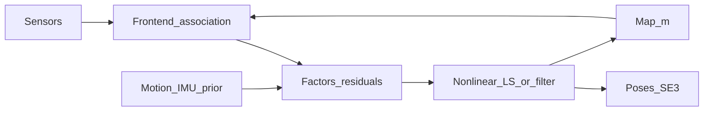
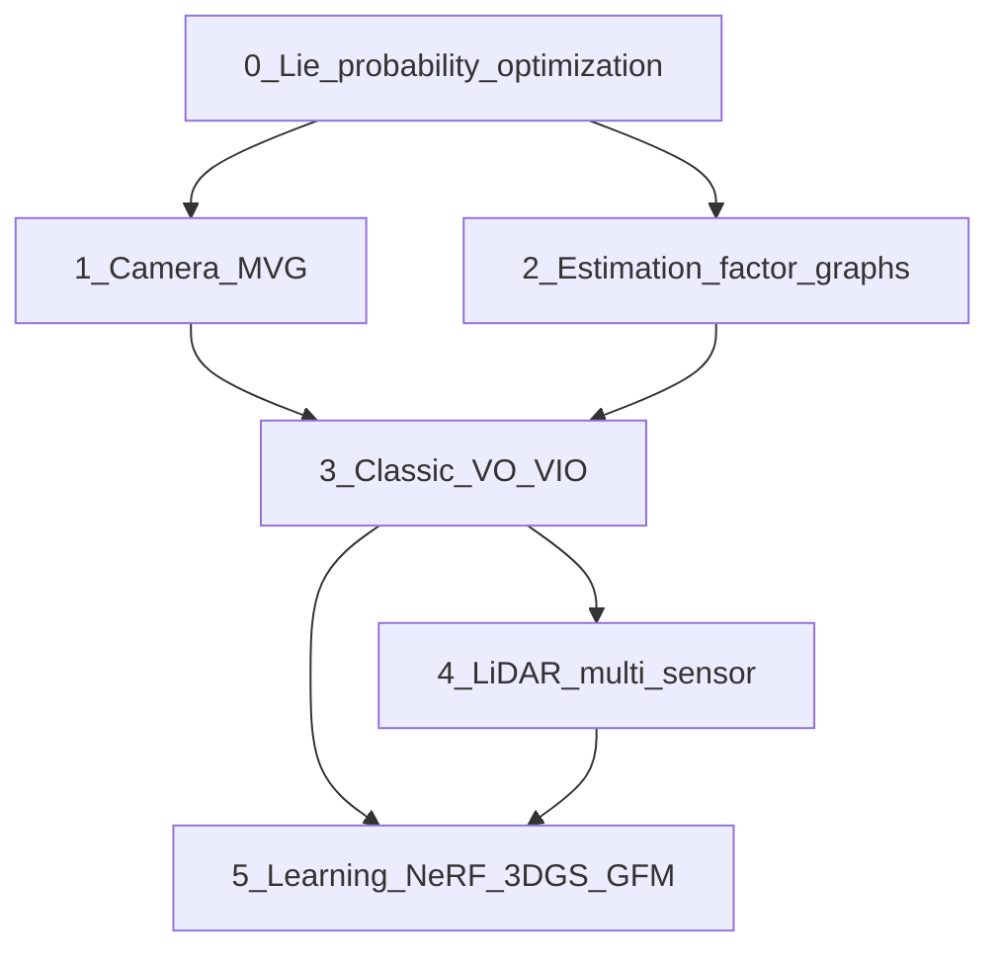
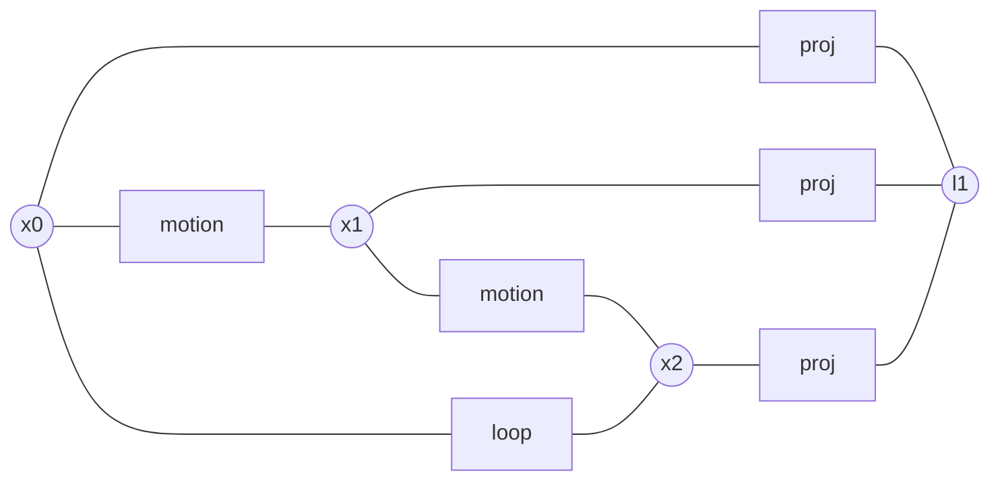
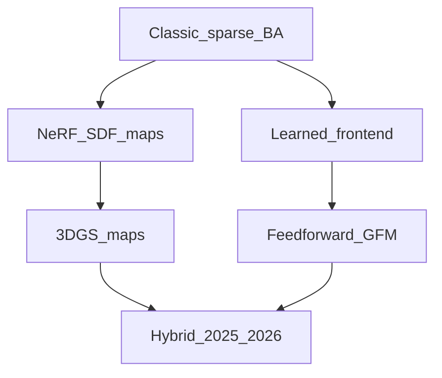

# SLAM 入门路径：面向数学背景

自学讲义。读完应能：用概率图把 SLAM 写成估计问题、知道自己缺哪块几何/优化、按阶段读什么写什么，并能把本仓库里的 ORB-SLAM3、VINS-Mono、A-LOAM、FAST-LIVO2 对上这条路径。假设你已有线性代数、多元微积分、概率论、数值优化的本科基础，但还没有系统学过机器人、计算机视觉或嵌入式。

配套交互总览：[SLAM 入门路径画布](/Users/peng/.cursor/projects/Users-peng-Downloads-Study/canvases/SLAM-learning-path.canvas.tsx)（可在聊天旁打开）。

## 目录

1. [SLAM 作为数学问题](#1-slam-作为数学问题)
2. [你已有什么、还缺什么](#2-你已有什么还缺什么)
3. [六阶段路径](#3-六阶段路径)
4. [阶段 0：从数学到机器人几何](#4-阶段-0从数学到机器人几何)
5. [阶段 1：相机与多视几何](#5-阶段-1相机与多视几何)
6. [阶段 2：状态估计与图优化](#6-阶段-2状态估计与图优化)
7. [阶段 3：经典视觉 / 视觉惯性系统](#7-阶段-3经典视觉--视觉惯性系统)
8. [阶段 4：激光与多传感器融合](#8-阶段-4激光与多传感器融合)
9. [阶段 5：学习、神经表示与前馈几何](#9-阶段-5学习神经表示与前馈几何)
10. [参考资料总表](#10-参考资料总表)
11. [领域发展状况（至 2026）](#11-领域发展状况至-2026)
12. [本仓库代码对照](#12-本仓库代码对照)
13. [数据集与评测](#13-数据集与评测)
14. [常见弯路](#14-常见弯路)
15. [自测](#15-自测)
16. [自测参考答案](#16-自测参考答案)

---

## 1. SLAM 作为数学问题

**同时定位与建图**（Simultaneous Localization and Mapping）要在未知环境里，一边估计传感器自身位姿，一边建立环境模型。它不是一个「算法名」，而是一类带隐变量的在线估计问题。

记时刻 $t$ 的传感器位姿为 $x_t \in \mathrm{SE}(3)$（或 $\mathrm{SE}(2)$），控制/里程计输入为 $u_t$，观测为 $z_t$，地图为 $m$（路标、点云、占据栅格、隐式场、高斯元……）。完整轨迹 $X = \{x_{0:T}\}$，观测 $Z = \{z_{1:T}\}$。目标是后验

$$
p(X, m \mid Z, U)
$$

或它的最大后验（MAP）点估计

$$
(X^\star, m^\star) = \arg\max_{X,m}\; p(Z \mid X, m)\, p(X \mid U)\, p(m).
$$

在高斯噪声与因子图（factor graph）语言下，这通常变成非线性最小二乘：

$$
\min_{X,m}\; \sum_k \big\| r_k(X, m)\big\|^2_{\Sigma_k}
$$

其中 $r_k$ 是运动、重投影、IMU 预积分、激光点到面等残差，$\|v\|^2_\Sigma = v^\top \Sigma^{-1} v$。

整条学习路径就是把上面四个块补全：

| 块 | 数学对象 | 工程对应 |
| --- | --- | --- |
| 状态 | 李群 $\mathrm{SE}(3)$、切空间 $\mathfrak{se}(3)$ | 位姿、速度、bias |
| 观测模型 | 投影、刚体变换、扫描匹配 | 相机 / 激光 / IMU |
| 数据关联 | 对应、外点、图匹配 | 特征、光流、最近邻 |
| 推断 | 滤波、平滑、鲁棒核 | EKF / BA / iSAM2 |

**前端**负责在当前帧里提出对应（谁和谁是同一个三维点）；**后端**在给定对应后做估计。初学者最容易的错觉是「SLAM = 调 ORB 参数」。真正难、也真正有数学含量的，是流形上的优化、可观性、以及错误关联如何毁掉一个凸看起来的问题。

---

## 2. 你已有什么、还缺什么

数学背景已经覆盖了读论文所需的语言的一半。缺的通常不是「更难的公式」，而是把公式接到传感器与软件上。

**已经够用的**

- 矩阵、特征值、最小二乘、Lagrange、Taylor
- 多元高斯、Bayes 公式、MLE / MAP
- 牛顿法、Gauss–Newton、Levenberg–Marquardt 的形式定义

**必须补、且越早越好的**

- 三维刚体运动不是 $\mathbb{R}^6$ 上的向量加法；旋转在 $\mathrm{SO}(3)$ 上
- 针孔相机把 $\mathbb{R}^3$ 投到 $\mathbb{P}^2$，深度不可直接观测
- IMU 给出的是比力与角速度，要积分，还有 bias
- C++ / Python、线性代数库、一次完整的「读数据集 → 跑开源系统 → 看轨迹误差」闭环

本仓库已经有一块很好的落点：

- 相机模型：[针孔与畸变讲义](../Camera/pinhole_distortion.md)
- 稀疏视觉：`ORB_SLAM3/`
- 视觉惯性：`VINS-Mono/`
- 激光里程计：`A-LOAM/`
- 激光视觉惯性：`FAST-LIVO2/`

不要从零再找一套互不相关的 demo。路径里每个阶段都尽量接到这些代码上。

时间预期（全职自学口径，可按课余 ×2）：阶段 0–2 约 3–4 个月能读懂经典论文公式；阶段 3–4 再 2–3 个月能改开源系统；阶段 5 是持续跟踪，不是「学完」。

---

## 3. 六阶段路径

阶段 0 与 1 可以部分并行（李群 + 相机）。阶段 2 必须在深入 ORB-SLAM / VINS 之前完成，否则后端会变成黑盒。阶段 4 与 5 在 3 之后分叉：做机器人/无人机偏 4，做视觉/图形学偏 5；两者最终会在多模态与「空间智能」处汇合。

每个阶段都按同一模板：**目标 → 数学清单 → 读什么 → 写/跑什么 → 过关标准**。

---

## 4. 阶段 0：从数学到机器人几何

**周期**：4–6 周。  
**目标**：能在纸上对旋转做扰动，能写一次 $\mathrm{SE}(3)$ 上的 Gauss–Newton 步。

### 4.1 必须建立的对象

刚体位姿是李群元素，不是 12 个数的任意矩阵：

$$
T = \begin{pmatrix} R & \mathbf{t} \\ \mathbf{0}^\top & 1 \end{pmatrix} \in \mathrm{SE}(3),\quad R \in \mathrm{SO}(3).
$$

指数映射把切空间向量变成群元。对旋转，$\boldsymbol{\phi}\in\mathbb{R}^3$，

$$
\exp(\boldsymbol{\phi}^\wedge) = I + \frac{\sin\theta}{\theta}\boldsymbol{\phi}^\wedge + \frac{1-\cos\theta}{\theta^2}(\boldsymbol{\phi}^\wedge)^2,
$$

其中 $\theta=\|\boldsymbol{\phi}\|$，$(\cdot)^\wedge$ 是反对称化。位姿扰动用**右扰动**或**左扰动**必须全程一致：

$$
T \leftarrow T \cdot \exp(\boldsymbol{\xi}^\wedge),\qquad \boldsymbol{\xi}\in\mathbb{R}^6.
$$

复合、逆、伴随 $\mathrm{Ad}_T$、以及把世界点变到相机

$$
\mathbf{P}_c = R\mathbf{P}_w + \mathbf{t}
$$

会反复出现。阶段 0 的考试不是背公式，而是：给定一个重投影误差，你能否对 $T$ 求正确的 $6\times 2$ 雅可比。

概率侧只需要把「多元高斯 + 信息矩阵 + 马氏距离」练熟。滤波以后再学；现在只要承认：**SLAM 后端几乎总是在流形上做加权非线性最小二乘**。

### 4.2 读什么

| 优先级 | 材料 | 用法 |
| --- | --- | --- |
| 必读 | Barfoot, *State Estimation for Robotics*, 第 6–8 章（李群、三维位姿、平滑） | 数学主线。免费 PDF：<https://github.com/utiasSTARS/state-estimation-book> 及 [作者页](http://asrl.utias.utoronto.ca/~tdb/bib/barfoot_ser17.pdf) |
| 必读 | Solà, *A micro Lie theory for state estimation in robotics* ([arXiv:1812.01537](https://arxiv.org/abs/1812.01537)) | 20 页把 $\mathrm{SO}(3)/\mathrm{SE}(3)$、扰动、雅可比讲完 |
| 必读 | 本仓库 [李群与李代数讲义](lie_groups.md) | 与 VINS-Mono 代码对照的精简版，Solà/Barfoot 的补充 |
| 选读 | *SLAM Handbook* Part I（2024–2025 公开稿） | 当代综述口径，[GitHub 公开版](https://github.com/SLAM-Handbook-contributors/slam-handbook-public-release) |
| 中文 | 高翔等《视觉 SLAM 十四讲》第 2–4 讲 | 用来对接 C++ 与 Eigen，不要当唯一理论源 |

十四讲适合「第一次把代码跑起来」。理论以 Barfoot / Solà 为准；十四讲里对李群、核函数、BA 的叙述有简化，读系统论文时要回到一手材料。

### 4.3 写/跑什么

1. 用 Python 或 C++ 实现 `SO3::exp/log`、`SE3::exp/log`，用有限差分核对。
2. 合成一个立方体上的三维点，给定真值位姿，加噪声投影，写一个只优化位姿的 Gauss–Newton（6 维）。
3. 把同一问题改成同时优化多个位姿 + 路标（这就是最简 BA），先不管鲁棒核。

### 4.4 过关

- 能默写右扰动下点变换对 $\boldsymbol{\xi}$ 的雅可比思路（不必背每一个元素）。
- 能解释为什么欧拉角 + $\mathbb{R}^3$ 加法在优化里会出万向节锁与不合法旋转。
- 你的 BA 在无外点时能收到真值附近，代价按二次下降。

---

## 5. 阶段 1：相机与多视几何

**周期**：4–6 周（你已完成针孔与畸变，可压缩到 3–4 周）。  
**目标**：从像素反推射线，做对极、三角化、PnP，并知道单目尺度不可观。

### 5.1 必须建立的对象

针孔与畸变见 [pinhole_distortion.md](../Camera/pinhole_distortion.md)。在此之上：

- **归一化平面** $(x,y)=(X/Z,\,Y/Z)$，像素 $u = f_x x + c_x$
- **本质矩阵 / 基础矩阵**：$ \mathbf{x}_2^\top E \mathbf{x}_1 = 0$，$E = [\mathbf{t}]_\times R$
- **三角化**：两条射线求三维点（DLT 或中点法）
- **PnP**：已知 3D–2D 对应求 $T\in\mathrm{SE}(3)$
- **对极搜索与单应**：纯旋转或平面场景时 $E$ 退化，要用 $H$
- **单目尺度**：相似变换 $\mathrm{Sim}(3)$ 下轨迹与地图可整体缩放；IMU 或立体 / 激光提供米制尺度

### 5.2 读什么

| 优先级 | 材料 | 用法 |
| --- | --- | --- |
| 必读 | Hartley & Zisserman, *Multiple View Geometry*, 第 6–13 章 | 相机、对极、三角化、自标定。不必整本做完 |
| 必读 | 十四讲第 5–8 讲，或 Gao & Zhang, *Introduction to Visual SLAM*（Springer, 2021）对应章节 | 特征、光流、PnP、ICP 的工程叙述 |
| 必读 | 本仓库 [光流法讲义](optical_flow.md) | 亮度恒定、Lucas–Kanade、金字塔；对照 `feature_tracker` |
| 选读 | OpenCV 文档：`calibrateCamera`、`recoverPose`、`solvePnP` | 对照实现 |
| 选读 | Scaramuzza & Fraundorfer, *Visual Odometry* 教程（Part I/II, IEEE RAM 2011–2012） | VO 与 SLAM 的边界 |

### 5.3 写/跑什么

1. 用棋盘或 Kalibr / OpenCV 标定一张针孔相机，写出 $K$ 与畸变，去畸变后做特征匹配。
2. 两帧：匹配 → 八点法估 $E$ → 分解 $R,t$ → 三角化。观察 $t$ 只有方向、没有尺度。
3. 多帧：对已有地图做 PnP，再把新点三角化进去。这就是最简视觉里程计。
4. 对照本仓库 VINS-Mono 的 `camera_model`，看工程里畸变与针孔如何拆开。

### 5.4 过关

- 能在白板上画出：世界点 → 相机 → 归一化 → 畸变 → 像素，并指出 SLAM 前端在哪一步去畸变。
- 能说明为何纯旋转无法三角化、为何走廊弱纹理会让 $E$ 估计崩溃。
- 能解释立体 / IMU / 已知物体尺寸各自如何钉住尺度。

---

## 6. 阶段 2：状态估计与图优化

**周期**：4–6 周。  
**目标**：把滤波与平滑看成同一 Bayes 问题的两种算法；能读懂一个因子图并手推一维例子。

### 6.1 滤波 vs 平滑

**滤波**维护当前信念 $p(x_t \mid z_{1:t}, u_{1:t})$，典型是 EKF / IEKF / 粒子滤波。优点是在线、常数时间；缺点是线性化点一旦错了难以回头，且地图一大，EKF 的协方差就是 $O(n^2)$。

**平滑**估计整条轨迹 $p(X \mid Z, U)$。视觉 SLAM 自 PTAM / ORB-SLAM 以来，后端主流是**窗口 BA + 位姿图回环**。因子图把每个测量画成一个因子，连接它涉及的变量：

高斯–牛顿把所有因子的残差堆成 $J^\top \Sigma^{-1} J \,\delta = -J^\top \Sigma^{-1} r$。稀疏性来自：每个因子只碰几个变量。增量平滑（iSAM2）用 Bayes 树在新因子进来时只重算受影响的团。

还要尽早建立三个「会让系统炸掉」的概念：

1. **可观性**：单目纯视觉对尺度、以及某些运动下的 IMU yaw / 尺度不可观。
2. **外点**：错误匹配不是高斯噪声。Huber / Cauchy / Geman–McClure 核把二次代价改成次二次。
3. **回环**：位姿图在 $\mathrm{SE}(3)$ 或 $\mathrm{Sim}(3)$ 上加一条边，修正累积漂移；地图也要跟着修正。

### 6.2 读什么

| 优先级 | 材料 | 用法 |
| --- | --- | --- |
| 必读 | Dellaert & Kaess, *Factor Graphs for Robot Perception*（Foundations and Trends, 2017） | 因子图圣经，比论文好读 |
| 必读 | Barfoot 第 4–5、8 章（EKF、平滑、MAP） | 与阶段 0 衔接 |
| 必读 | 本仓库 [IMU 预积分讲义](imu_preintegration.md) | 读 VINS 前补 IMU / Forster；无 IMU 背景可先读这个再读论文 |
| 必读 | Cadena et al., *Past, Present, and Future of Simultaneous Localization and Mapping*, IEEE TRO 2016 | 分野的标准综述，现在读是为了知道 2016 年认为「已解决 / 未解决」的是什么 |
| 选读 | Kaess et al., iSAM2, IJRR 2012 | 增量平滑 |
| 选读 | Rosen et al., SE-Sync / certifiable estimation | 知道全局最优与验证存在，不必实现 |
| 工具文档 | [Ceres Solver](http://ceres-solver.org/)、[GTSAM](https://gtsam.org/)、[g2o](https://github.com/RainerKuemmerle/g2o) | 选一个深入 |

### 6.3 写/跑什么

1. 一维：机器人在线上走，测距到若干路标。分别用 EKF 与批量最小二乘，画协方差。
2. 用 GTSAM 或 Ceres 搭一个 2D 位姿图（`SE(2)`），加入一个回环，看轨迹被「拉直」。
3. 把阶段 0 的 BA 加上 Huber 核，再人为加 20% 错匹配，看核函数如何救优化。

### 6.4 过关

- 能把「前端给错对应」翻译成「因子图里多了一条错误的强约束」。
- 能说明为何 ORB-SLAM 要关键帧、局部 BA、本质图、回环后的全局 BA——这是计算预算与一致性的折中，不是工程癖好。
- 能写出 IMU 预积分要消除的是什么（在离散区间上把 bias 线性化，使预积分量在 bias 更新时可用一阶修正，而不必重积分）。细节见本仓库 [IMU 预积分讲义](imu_preintegration.md)，阶段 3 读 VINS 因子时对照。

---

## 7. 阶段 3：经典视觉 / 视觉惯性系统

**周期**：6–10 周。  
**目标**：精读并跑通一套特征法、一套紧耦合 VIO；能指出每条线程在因子图里对应什么。

这是从「会公式」到「会系统」的跳变。不要同时开五个系统。建议顺序：

1. **ORB-SLAM3**（本仓库已有）：单目 / 双目 / RGB-D / IMU，特征点 + 词袋回环，当代稀疏几何 SLAM 的参照实现。
2. **VINS-Mono**（本仓库已有）：紧耦合视觉惯性，滑窗优化 + IMU 预积分，工程上比 ORB-SLAM 的 IMU 部分更「教科书」。
3. 有余力再看 **DSO / DM-VIO**（直接法）或 **OKVIS2**，理解灰度误差 vs 重投影误差。

### 7.1 系统解剖清单（对着源码打钩）

对每个系统至少能回答：

- 前端关联是描述子匹配、光流，还是两者都有？
- 初始化如何给尺度与重力？（VINS 的视觉 SfM + IMU 对齐是必懂段落）
- 状态向量里有哪些量？哪些边缘化掉？Schur 补出现在哪？
- 回环用什么描述子 / 词袋？回环后是位姿图还是全 BA？
- 地图是稀疏路标、半稠密、还是根本不维护全局点？

### 7.2 读什么

| 系统 | 论文 | 代码入口 |
| --- | --- | --- |
| ORB-SLAM3 | Campos et al., IEEE TRO 2021 | 本仓库 `ORB_SLAM3/`；先读 `System.cc`、`Tracking.cc`、`LocalMapping.cc`、`LoopClosing.cc` |
| ORB-SLAM 系列前传 | Mur-Artal TRO 2015 / 2017 | 理解词袋与关键帧管理从哪来 |
| VINS-Mono | Qin et al., IEEE TRO 2018 | 本仓库 `VINS-Mono/`；系统对照见 [vins_mono.md](vins_mono.md)。预积分先读 [讲义](imu_preintegration.md) 再对 `integration_base.h` |
| IMU 预积分 | Forster et al., *On-Manifold Preintegration*, TRO 2017 | VINS / ORB-SLAM3 IMU 的共同祖先；中文推导见 [imu_preintegration.md](imu_preintegration.md) |
| 直接法对照 | Engel et al., DSO, TPAMI 2018 | 知道光度误差长什么样即可 |
| 学习前端对照 | Teed & Deng, DROID-SLAM, CVPR 2021 | 阶段 5 的跳板：把 BA 做成可微层 |

中文辅助：崔华坤等对 VINS / ORB 的博客与「从零写 VIO」系列可以当导读，但公式以论文为准。

### 7.3 写/跑什么

1. EuRoC `MH_01` 上分别跑 ORB-SLAM3（单目、单目+IMU）与 VINS-Mono，用 evo 算 ATE / RPE。
2. 画一条自己的「失败实验」：遮挡镜头 2 秒、快速晃动、弱光。记录谁跟丢、谁能重定位。
3. 在 VINS 里加日志：打印预积分残差、视觉残差、bias。改一个外参或故意把 `td`（相机–IMU 时间偏移）设错，看残差如何变。
4. 选一个小改动：例如把 ORB 提取改成 SuperPoint（先不必求精度），只为走通「前端可替换」。

### 7.4 过关

- 能向另一个数学背景的人，用因子图表述 ORB-SLAM3 与 VINS-Mono 的后端差异（关键帧 BA vs 固定滑窗 + 边缘化）。
- 能解释单目 VIO 初始化失败的典型原因：运动激励不足、加速度太小、视觉尺度与 IMU 对不齐。
- 能用 ATE 数字而不是「看起来挺准」评价一次运行。

---

## 8. 阶段 4：激光与多传感器融合

**周期**：4–6 周。  
**目标**：理解点到面 ICP、IMU 紧耦合 LIO、以及视觉如何补激光的退化。

激光给出的是**带度量的 3D 点**，没有单目尺度问题，但有运动畸变、非重复扫描、以及长走廊 / 空旷场地的几何退化。视觉给出的是**纹理与回环外观**，弱光与高速时会挂。紧耦合的意义是：同一个状态，同时吃两种残差。

### 8.1 必懂模块

- 点到点 / 点到面 ICP，以及 LOAM 把特征拆成边、面的思想
- 激光运动补偿（sweep 内用 IMU 或匀速模型去畸变）
- FAST-LIO 系：iKFoM（流形迭代卡尔曼）把扫描匹配残差喂给 IEKF，比纯图优化更常见于高速雷达
- 视觉激光：把视觉特征或直接光度挂到同一地图（本仓库 FAST-LIVO2）

### 8.2 读什么

| 优先级 | 材料 | 用法 |
| --- | --- | --- |
| 必读 | Zhang & Singh, LOAM, RSS 2014 | 激光里程计的概念源头 |
| 必读 | Xu et al., FAST-LIO / FAST-LIO2, 2021–2022 | 当代 LIO 工程标准 |
| 必读 | FAST-LIVO / FAST-LIVO2（本仓库 `FAST-LIVO2/`） | 视觉直接法 + 激光 + IMU |
| 对照 | Shan et al., LIO-SAM, IROS 2020 | 图优化风格的 LIO，便于和阶段 2 对照 |
| 选读 | Behley & Stachniss, SuMa；Vizzo et al., KISS-ICP | 稠密激光与「简单反而稳」 |

本仓库 `A-LOAM/` 是 LOAM 的 A-LOAM 重写，适合先跑再读 FAST-LIO。

### 8.3 写/跑什么

1. 用公开数据集（Newer College、NTU VIRAL、或 FAST-LIVO2 文档推荐序列）跑 A-LOAM 与 FAST-LIVO2。
2. 只实现一个点到面 ICP 的 Gauss–Newton，配准两帧扫描。
3. 故意去掉 IMU，看纯激光在快速旋转时拖影与漂移。

### 8.4 过关

- 能说明为何空旷场地激光会退化、视觉却可能仍有远处特征。
- 能对比「IEKF 扫一遍就更新」和「滑窗 BA」在延迟与一致性上的取舍。
- 能指出 FAST-LIVO2 相对 VINS-Mono 多了什么观测因子。

---

## 9. 阶段 5：学习、神经表示与前馈几何

**周期**：持续跟踪，先用 4–6 周建立地图。  
**目标**：分清三条已经分叉、又正在汇合的技术线；能读 2024–2026 的调查而不迷路。

不要一上来训练 NeRF。先建立分类，再各读一篇代表作。

### 9.1 三条线

**A. 学习增强的几何 SLAM（2016–）**

前端或数据关联换成网络：SuperPoint、SuperGlue、LightGlue；或把光流 / 深度当作输入（DROID-SLAM、DPVO）。后端仍是 BA。数学没变，似然模型变了。

**B. 神经隐式 / 显式辐射场地图（2021–）**

地图不再是稀疏点，而是 MLP（NeRF / SDF）或 3D 高斯（3DGS）。跟踪通过对渲染图像求光度误差反传位姿。代表：iMAP、NICE-SLAM、ESLAM、GO-SLAM；3DGS 侧：SplaTAM、MonoGS（Gaussian Splatting SLAM）、GS-SLAM、Photo-SLAM、LVI-GS。

**C. 前馈几何基础模型 GFM（2024–，当前最热）**

DUSt3R / MASt3R 从**未标定**图像对直接吐出两帧点云；VGGT 一次吃多帧，同时估深度、位姿、内参。SLAM 变成：如何把有限窗口的前馈输出，用经典后端拼成无限长轨迹。代表：MASt3R-SLAM、VGGT-SLAM（在 $\mathrm{SL}(4)$ 上对齐子图）、VGGT-SLAM 2.0、SLAM3R。共识是 **Deep prior + 经典优化**，而不是纯端到端替换 BA。

### 9.2 读什么（按这条顺序，不要并行五篇）

1. Teed & Deng, DROID-SLAM, CVPR 2021 — 可微 BA。
2. Tosi et al., *How NeRFs and 3D Gaussian Splatting Are Reshaping SLAM*, IEEE TRO 2026（预印本 [arXiv:2402.13255](https://arxiv.org/abs/2402.13255)）— 用地图表示把神经 SLAM 串起来。
3. Matsuki et al., *Gaussian Splatting SLAM* (MonoGS), CVPR 2024。
4. DUSt3R (ECCV 2024) → MASt3R → VGGT (CVPR 2025)。
5. Murai et al., MASt3R-SLAM；Maggio et al., VGGT-SLAM, 2025（$\mathrm{SL}(4)$ 子图对齐）。
6. *SLAM Handbook* Part III：Spatial Intelligence 各章 — 语义、动态、终身、多机器人。

### 9.3 写/跑什么

1. 跑通 MonoGS 或 SplaTAM 的一个室内 RGB-D 序列，对比 ORB-SLAM3 的轨迹精度与地图可看性。二者优化目标不同：一个是定位精度，一个是新视角合成。
2. 读 VGGT 官方 demo：丢几张未标定照片，看它吐出的点云与位姿。用手算对极几何核对一对重叠图。
3. 写一篇一页纸笔记：*「若 GFM 给的是项目变换意义下的子图，为什么 $\mathrm{Sim}(3)$ 不够、需要 $\mathrm{SL}(4)$？」* 这是在用阶段 0–1 的数学吃最新论文。

### 9.4 过关

- 能用「地图表示 × 前端关联 × 后端流形」三轴给一篇新 SLAM 论文归类。
- 能说出神经 / 3DGS / GFM 各自最致命的短板（速度与可编辑性、室外与光照、显存与分布外）。
- 不把「渲染好看」和「ATE 小」当成同一指标。

---

## 10. 参考资料总表

### 10.1 书与长期讲义

| 资源 | 适合阶段 | 备注 |
| --- | --- | --- |
| [SLAM Handbook](https://github.com/SLAM-Handbook-contributors/slam-handbook-public-release)（Carlone, Kim, Barfoot, Cremers, Dellaert 主编，CUP，公开稿 2024–2025，纸书约 2026） | 全程地图；Part I 理论，II 系统，III 空间智能 | **2025–2026 最该收藏的一本**。免费 PDF 与章节引用见仓库 |
| Barfoot, *State Estimation for Robotics* | 0, 2 | 估计理论标准教材 |
| Hartley & Zisserman, *Multiple View Geometry* | 1 | 多视几何标准教材 |
| Gao & Zhang, *Introduction to Visual SLAM*, Springer 2021（十四讲英译） | 1, 3 | 中文读者的工程入门 |
| Dellaert & Kaess, *Factor Graphs for Robot Perception* | 2 | 因子图 |
| Thrun, Burgard, Fox, *Probabilistic Robotics* | 2（滤波史） | EKF-SLAM / FastSLAM 背景，不必整本 |
| Corke, *Robotics, Vision and Control* | 0 补机器人直觉 | 有 Python / MATLAB 实验 |

### 10.2 必读论文（按读的顺序，不是按引用）

1. Cadena et al., TRO 2016 — 分野。
2. Solà, arXiv:1812.01537 — 李群。
3. Forster et al., TRO 2017 — IMU 预积分（先读本仓库 [讲义](imu_preintegration.md)）。
4. Mur-Artal & Tardós, ORB-SLAM2, TRO 2017；Campos et al., ORB-SLAM3, TRO 2021。
5. Qin et al., VINS-Mono, TRO 2018。
6. Engel et al., DSO, TPAMI 2018。
7. Zhang & Singh, LOAM, RSS 2014；Xu et al., FAST-LIO2。
8. Teed & Deng, DROID-SLAM, CVPR 2021。
9. Tosi et al., TRO 2026 / arXiv:2402.13255 — 神经与 3DGS SLAM 调查。
10. Wang et al., DUSt3R, ECCV 2024；VGGT；MASt3R-SLAM；VGGT-SLAM 2025。

### 10.3 课程与视频

| 课程 | 用途 |
| --- | --- |
| ETH Zurich, *Vision Algorithms for Mobile Robotics*（Scaramuzza） | 视觉里程计与多视，有作业 |
| UPenn / Coursera, *Robotics: Estimation and Learning* 或 Kumar 组飞行课中的状态估计部分 | 滤波直觉 |
| Cyrill Stachniss YouTube（Bonn） | 激光、图 SLAM、ICP 讲解极清楚 |
| TUM Cremers / Dellaert GTSAM tutorial | 直接法与因子图 |
| 高翔「SLAM 十四讲」配套视频 | 中文过一遍代码 |

### 10.4 库与工具（阶段 2 之后再深挖）

- 优化：Ceres、g2o、GTSAM、tiny-solver
- 流形 / IEKF：sophus、manif、[IKFoM](https://github.com/hku-mars/IKFoM)
- 视觉：OpenCV、OpenGV、colmap（离线 SfM，用来对照在线 SLAM）
- 评测：[evo](https://github.com/MichaelGrupp/evo)、rpg_trajectory_evaluation
- 标定：Kalibr（相机–IMU）、lidar_align、OpenCV calibrate

---

## 11. 领域发展状况（至 2026）

下面按「已经工程化的」和「论文里正在换血的」分开写。两者同时为真，不要用后者否定前者。

### 11.1 四次范式转移

| 年代 | 范式 | 代表 | 留下了什么 |
| --- | --- | --- | --- |
| 2000s | 滤波 SLAM | EKF-SLAM、FastSLAM | 问题定义、可观性、数据关联 |
| 2010s | 图优化 / 关键帧 | PTAM、ORB-SLAM、OKVIS、VINS | **工业主力仍在这里** |
| 2018–2023 | 学习前端 + 可微 BA | SuperGlue、DROID、深度学习回环 | 弱纹理与外观变化 |
| 2021–2024 | 神经隐式地图 | iMAP、NICE-SLAM | 可渲染地图，但慢、难编辑 |
| 2023–2026 | 3DGS 地图 | MonoGS、SplaTAM、LVI-GS | 实时高保真、可编辑 |
| 2024–2026 | 前馈几何基础模型 | DUSt3R、MASt3R、VGGT、*–SLAM | 未标定、稠密、子图拼接；后端流形从 $\mathrm{SE}(3)$ 扩到 $\mathrm{Sim}(3)$ 甚至 $\mathrm{SL}(4)$ |

Davison 等人把下一阶段叫 **Spatial AI**：地图不只是给机器人避障的点，还要可渲染、可语义查询、可多代理共享、可在动态与长期变化里活下去。*SLAM Handbook* 的编辑意图就是把书从「定位建图手册」写成「空间智能手册」。

### 11.2 工业与应用侧（2026 的实话）

- **无人机、扫地机器人、仓储、AR 眼镜**：仍然是 VIO + 少量学习前端 + 词袋/学习回环。ORB / VINS / FAST-LIO 家族及其用产品改巴的版本在跑。约束是功耗、标定、以及「不能花 24 GB 显存」。
- **自动驾驶**：更常做的是**高精度地图上的定位**（NDT、视觉语义定位），而不是从零 SLAM。SLAM 用在建图车与停车场等受限区域。
- **消费 AR**（ARKit / ARCore）：视觉惯性 + 平面检测 + 云端重定位；对外不叫 SLAM，结构是 VIO。
- **数字孪生 / 影视 / 扫描**：NeRF / 3DGS 很强，但多数是**离线重建**（COLMAP + 3DGS），不是在线 SLAM。在线 3DGS-SLAM 仍以室内、RGB-D 或有激光为舒适区。

一篇 2024 年底的野外评测（*NeRF and Gaussian Splatting SLAM in the Wild*）说得很清楚：室外光照与季节变化下，**经典方法跨季节更稳，神经方法在低光有时更稳，但算力贵**；两边都还没「解决野外」。

### 11.3 2025–2026 论文主线

1. **GFM + 经典后端**  
   MASt3R-SLAM 用双帧模型 + $\mathrm{Sim}(3)$ 位姿图做实时稠密单目。VGGT-SLAM 指出：VGGT 子图之间一般不是相似变换，对齐应在 $\mathrm{SL}(4)$（三维射影变换，行列式 1）上做。这是「用 2026 的网络，做 2000 年的多视几何」——阶段 0–1 没有过期。

2. **3DGS 从室内 RGB-D 走向多传感器**  
   激光着色点初始化高斯、深度损失钉几何、金字塔训练（如 LVI-GS）。单目 3DGS 仍受尺度与几何漂移折磨，于是出现用 VGGT / 深度网络当几何先验的 GeoGS-SLAM 一类工作。

3. **混合而不是替换**  
   纯前馈长序列会漂、会双墙、会在分布外崩。SOTA 叙述变成：网络给稠密对应或子图，BA / 位姿图给全局一致性与回环。

4. **语义、动态、多机器人、终身地图**  
   开放问题与 2016 Cadena 文里列出的高度重合，只是地图表示换了。动态物体、地图过期、多机通信与子图融合，仍然没有封闭解。

### 11.4 仍然开放的问题（读新论文时的坐标系）

- **鲁棒性**：动态场景、透明反射、季节与光照、高速运动模糊、退化运动（匀速直线、纯旋转）。
- **可观性与标定**：未标定 GFM 很好用，但度量尺度、内参漂移、相机–IMU–激光外参仍是产品生死线。
- **不确定性**：学习系统很少给出校准过的协方差；下游规划不敢直接用。
- **长期与大规模**：回环只能修闭合路径；环境变了要「遗忘」还是「多层地图」未决。VGGT 一类模型还受显存帧数墙（消费卡约几十帧）限制。
- **评测错位**：ATE / RPE 不衡量地图能否渲染、能否做操作；PSNR 不衡量位姿是否可规划。新系统必须看它报了哪张表。
- **边缘部署**：论文在 4090 上实时，不等于机载实时。

### 11.5 对数学背景读者的一句判断

2026 年的 SLAM 并没有变成「只会调 Transformer」。相反，最新的 VGGT-SLAM 把后端流形从 $\mathrm{SE}(3)$ 抬到 $\mathrm{SL}(4)$，这是在**加重**对李群、射影几何与因子图的要求。网络降低了标定与特征设计的门槛，提高了对齐与可观性分析的门槛。按本路径把阶段 0–2 学扎实，比先刷十篇 CVPR 更接近能做研究。

---

## 12. 本仓库代码对照

| 仓库 | 放在路径的哪 | 先看什么 |
| --- | --- | --- |
| `StudyNote/Camera/pinhole_distortion.md` | 阶段 1 | 投影与去畸变 |
| `StudyNote/SLAM/imu_preintegration.md` | 阶段 2–3 | 从 IMU 物理沿 VINS `processIMU` 推到预积分与 `evaluate` 的 15 维残差 |
| `ORB_SLAM3/` | 阶段 3 | 线程结构、ORBextractor、Optimizer、LoopClosing |
| `VINS-Mono/` | 阶段 3 | `factor/` 下 IMU 与视觉残差；`initial/` 初始化 |
| `A-LOAM/` | 阶段 4 | 边面特征与扫描匹配 |
| `FAST-LIVO2/` | 阶段 4，并向 5 延伸 | 直接视觉 + 激光地图；读仓库 `Log/guide.md` |

建议的仓库内实践顺序：畸变讲义 → 李群讲义 → 自己写 6-DoF BA → [预积分讲义](imu_preintegration.md) → EuRoC 上 ORB-SLAM3 → 同一序列 VINS-Mono → A-LOAM 看点到面 → FAST-LIVO2 看融合。每一跳只增加一种传感器或一种后端，不要跳级。

---

## 13. 数据集与评测

| 数据集 | 传感器 | 阶段 | 注意 |
| --- | --- | --- | --- |
| [EuRoC MAV](https://projects.asl.ethz.ch/datasets/doku.php?id=kmavvisualinertialdatasets) | 双目 + IMU | 3 | VIO 标准；先 `MH_01_easy` |
| [TUM RGB-D](https://cvpr.in.tum.de/data/datasets/rgbd-dataset) | RGB-D | 3, 5 | 室内，神经 / 3DGS 常用 |
| [KITTI Odometry](https://www.cvlibs.net/datasets/kitti/eval_odometry.php) | 双目 + 激光 | 3, 4 | 车载，运动退化少、回环少 |
| [Newer College](https://ori-drs.github.io/newer-college-dataset/) | 激光 + 相机 + IMU | 4 | 现代 LIO |
| Replica / ScanNet | RGB-D 重建 | 5 | 渲染指标（PSNR/SSIM/LPIPS） |
| Hilti / Wildcat / 各种 SLAM challenge | 多传感器困难场景 | 3 以后 | 用来打掉「数据集过拟合」幻觉 |

轨迹指标：

- **ATE**（Absolute Trajectory Error）：对齐后的绝对位置 RMSE，看全局漂移。
- **RPE**（Relative Pose Error）：固定间隔上的相对误差，看局部里程计。
- 单目必须先做 $\mathrm{Sim}(3)$ 对齐再比 ATE，否则尺度差会被当成误差。

地图指标（阶段 5 才需要认真对待）：精度 / 完整度、F-score、以及新视角合成的 PSNR。写报告时写明对齐方式（$\mathrm{SE}(3)$ 还是 $\mathrm{Sim}(3)$）、是否插值时间戳。

---

## 14. 常见弯路

1. **先训网络再补几何。** 弱纹理上 SuperPoint 确实更香，但你无法调试「为什么 BA 不收敛」。
2. **把十四讲当终点。** 它是优秀的工程入门，不是估计理论。
3. **同时 clone 十个 SLAM。** 系统是靠重复跑同一序列、改同一处残差学会的。
4. **用欧拉角写后端。** 演示可以，产品与论文都用李代数扰动。
5. **只看室内 RGB-D 的漂亮图就认为野外已解决。** 见 11.2。
6. **忽略标定与时钟。** 一半「算法不行」其实是外参、曝光、或相机–IMU 时间偏移。
7. **没有评测脚本。** 从第一次跑 EuRoC 就接 evo，形成肌肉记忆。
8. **跳过初始化。** VIO / 单目的 bug 大量死在前 10 秒，而不是在回环。

---

## 15. 自测

闭卷回答。写不出就回到对应阶段，不要用「大概懂」跳过。

1. 为什么旋转不能当成 $\mathbb{R}^3$ 向量做加法？优化时正确的做法是什么？
2. 写出针孔投影 $\pi(T, \mathbf{P})$，并说明单目序列的尺度不可观对应哪个变换群的自由度。
3. 因子图里一个视觉重投影因子连接哪些变量？错误匹配进入图后，不用鲁棒核会发生什么？
4. 滤波与平滑对同一 Bayes 问题的近似有何不同？ORB-SLAM 局部 BA 属于哪一类？
5. VINS-Mono 为什么需要 IMU 预积分？bias 更新时为什么不必重积整段 IMU？
6. 长走廊里纯激光 LOAM 可能怎样失败？视觉或 IMU 各能补什么？
7. 3DGS-SLAM 优化的主要误差通常是什么？它小是否意味着 ATE 小？
8. VGGT 子图对齐为什么有时要用 $\mathrm{SL}(4)$ 而不是 $\mathrm{SE}(3)$ 或 $\mathrm{Sim}(3)$？
9. 举一个 2016 年 Cadena 文里已列出、2026 年仍未封闭的问题，并说明神经地图有没有自动解决它。
10. 给你 EuRoC 上两条轨迹，ATE 分别为 0.08 m 与 0.12 m。还需要问哪三个问题才能决定谁更好？

---

## 16. 自测参考答案

1. $\mathrm{SO}(3)$ 不是向量空间：两个旋转矩阵相加一般不是旋转，欧拉角加法还过不了奇异点。做法是在切空间取 $\boldsymbol{\phi}\in\mathbb{R}^3$，用 $R \leftarrow R\exp(\boldsymbol{\phi}^\wedge)$（或左扰动）更新，对 $\boldsymbol{\phi}$ 做线性化。
2. $\pi(T,\mathbf{P}) = K\,\Pi(R\mathbf{P}+\mathbf{t})$，$\Pi(X,Y,Z)=(X/Z,Y/Z)$。整体相似变换 $(R,t,s)$ 不改变无标定单目的重投影（尺度与部分绝对位姿不可观），对齐轨迹时用 $\mathrm{Sim}(3)$。
3. 通常连接一个位姿 $x_i$ 与一个路标 $l_j$（有时还有相机内参、时间偏移）。错匹配给出错误的强二次约束，会把轨迹和地图一起拉歪；Huber 等核降低大残差的权重，RANSAC 则尽量不让错因子进图。
4. 滤波只条件于过去、递推当前状态；平滑用整段（或窗口内）观测联合估计。局部 BA 是窗口平滑。
5. 预积分把两次图像之间的 IMU 测量收成与绝对位姿无关、只依赖相对运动与 bias 的因子，使图像频率上的 BA 不必每次重积 IMU。Forster 把预积分量对 bias 的一阶偏导存下来，bias 小更新时线性修正即可。
6. 走廊里点到面法向几乎共线，沿走廊的平移不可观，扫描匹配会沿管道滑动。视觉可用远处或侧面纹理钉住；IMU 短时提供加速度与角速度，但不能单独消灭长期漂移。
7. 主要是渲染图像与观测图像的光度（再加深度/几何正则）。PSNR 高只说明地图好看，位姿仍可能沿光度平坦方向漂；必须单独报 ATE。
8. VGGT 从无标定图像回归的子图，相差的一般是三维射影变换（单应在 $\mathbb{P}^3$ 上），不是刚体或相似。$\mathrm{SL}(4)$ 是行列式为 1 的 $4\times 4$ 矩阵群，正好参数化这类对齐；只用 $\mathrm{Sim}(3)$ 会留下无法消掉的射影畸变。
9. 例如动态物体、终身地图更新、或校准过的不确定性。换 NeRF / 3DGS 只换了 $m$ 的参数化，没有自动给出动态分解或可校准协方差；野外评测显示跨季节仍弱。
10. 至少问：单目还是双目/IMU（是否 $\mathrm{Sim}(3)$ 对齐）、对齐与时间戳插值协议、哪一段（是否含初始化）、失败/跟丢次数、以及算力与传感器。只比两个标量 ATE 没有意义。
