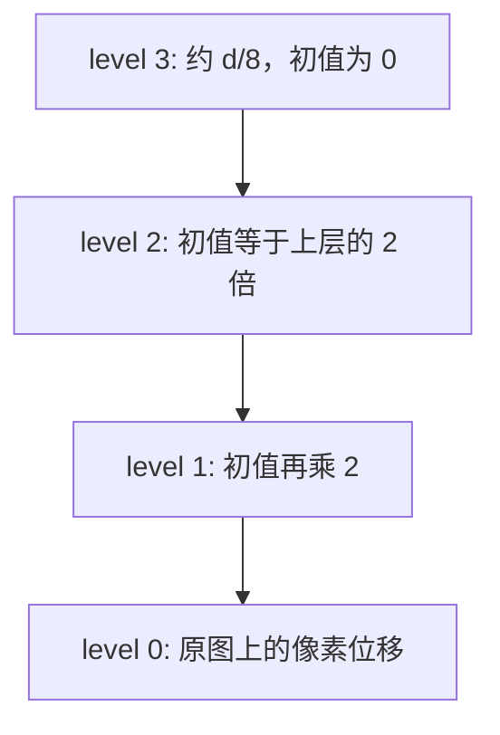

# 光流法：从亮度恒定到金字塔 Lucas–Kanade

自学讲义。面向**有本科线代、微积分与最小二乘基础，但还没有系统学过图像运动估计**的读者。本文从「同一个物理点在两帧里灰度相近」推到稀疏光流的正规方程、迭代和图像金字塔，再落到本仓库 [`VINS-Mono`](../../VINS-Mono/) 的 `FeatureTracker::readImage`。

读完应能：

- 从亮度恒定写出光流约束，并说明一个像素为什么定不出二维位移；
- 手推窗口上的 Lucas–Kanade 正规方程，判断结构张量何时可逆；
- 说明金字塔在解决哪一步的线性化，以及 `maxLevel = 3` 时位移怎样从粗层传到原图；
- 指出 `calcOpticalFlowPyrLK` 的窗口、`status`、`err` 各是什么，以及这次调用用了哪些 OpenCV 默认值；
- 沿 `readImage` 分开：哪一步是光流，哪一步已经是角点检测或对极外点。

配套材料，本文不重复推导：

- 去畸变与 `liftProjective`：见 [针孔与畸变讲义](../Camera/pinhole_distortion.md)。
- 特征进滑窗之后的重投影、时间偏移 \(t_d\)：见 [VINS-Mono 讲义](vins_mono.md) §4 与 §8.4。
- 这条前端在整条学习路径上的位置：见 [SLAM 入门路径](learning_path.md) 阶段 1。

公式主线是 Lucas–Kanade（IJCAI 1981）加上 Bouguet 的金字塔实现（Intel，2001），符号按两帧位移来写，以便直接对照 OpenCV。

---

## 目录

1. [读本文之前](#1-读本文之前)
2. [光流在估什么](#2-光流在估什么)
3. [亮度恒定](#3-亮度恒定)
4. [光流约束与孔径问题](#4-光流约束与孔径问题)
5. [Lucas–Kanade](#5-lucaskanade)
6. [四像素手算](#6-四像素手算)
7. [迭代：Gauss–Newton 与双线性采样](#7-迭代gaussnewton-与双线性采样)
8. [图像金字塔](#8-图像金字塔)
9. [`calcOpticalFlowPyrLK` 的这次调用](#9-calcopticalflowpyrlk-的这次调用)
10. [点从哪来：Shi–Tomasi 与 mask](#10-点从哪来shitomasi-与-mask)
11. [接到 `readImage`，停在光流的边界](#11-接到-readimage停在光流的边界)
12. [Horn–Schunck，以及后来的光流](#12-hornschunck以及后来的光流)
13. [失败模式](#13-失败模式)
14. [掌握清单](#14-掌握清单)
15. [自测与参考答案](#15-自测与参考答案)

---

## 1. 读本文之前

你需要会：

- **向量与矩阵**：把一组标量方程写成 \(A\mathbf{d}=\mathbf{b}\)，以及正规方程 \(A^\top A\,\mathbf{d}=A^\top\mathbf{b}\)。
- **多元微积分**：一阶 Taylor，二元函数的梯度 \(\nabla I=(I_x,I_y)\)。
- **最小二乘**：超定方程组的最小二乘解；知道 \(2\times 2\) 对称矩阵可逆当且仅当两个特征值都非零。

不需要：相机标定的细节、对极几何的推导、神经网络。灰度图在本文里就是一个函数 \(I\)，像素坐标 \((x,y)\)，灰度是标量。

---

## 2. 光流在估什么

**光流**是图像上的二维运动：同一个物理表面点，从上一帧的像素走到下一帧的像素，位移是 \((d_x,d_y)\)。连续时间里把这段位移除以时间，就得到速度 \((u,v)=(d_x/\Delta t,\, d_y/\Delta t)\)，单位是像素每秒。两帧算法直接估的是位移；VINS 在光流结束之后，才在归一化平面上把位移除以 \(\Delta t\) 做成速度。

它和另外两个量用的是不同的未知数：

- **场景流**是点在三维空间里的速度。光流是场景流与相机自身运动一起投影到像平面之后的结果。只看图像，深度和三维速度缠在同一个 \((d_x,d_y)\) 里，拆不开。
- **描述子匹配**给每个点一个向量（ORB、BRIEF），再在另一帧里找最近邻。对应可以跳很大一段运动，也可以在丢失之后重新认出来。光流要求两帧外观还落在局部光度最小附近，跟踪断了就没有描述子可用来找回这个 id。

VINS-Mono 的短时跟踪走光流：每个点保留一个整数 id，靠 LK 从上一帧推到下一帧。回环节点才计算 BRIEF。稀疏光流因此是一条**数据关联**，后端拿到的是「id \(i\) 在两帧的归一化坐标」，再写成重投影残差。

整条链是：


本文的主体是前四步。边界检查、对极 RANSAC、归一化速度仍然出现在第 11 节，因为它们紧挨在同一次 `readImage` 里，但它们各自有自己的模型。

---

## 3. 亮度恒定

把灰度写成 \(I(x,y,t)\)。亮度恒定说：物体表面同一个点，在很短的时间里，相机记下的灰度不变。点从 \((x,y)\) 走到 \((x+\mathrm{d}x,\, y+\mathrm{d}y)\)，则

$$
I(x,y,t)
=
I(x+\mathrm{d}x,\, y+\mathrm{d}y,\, t+\mathrm{d}t).
$$

右边在 \((x,y,t)\) 处一阶展开：

$$
I(x+\mathrm{d}x,\, y+\mathrm{d}y,\, t+\mathrm{d}t)
\approx
I
+
I_x\,\mathrm{d}x
+
I_y\,\mathrm{d}y
+
I_t\,\mathrm{d}t.
$$

与左边相减，得到

$$
I_x\,\mathrm{d}x + I_y\,\mathrm{d}y + I_t\,\mathrm{d}t = 0.
$$

记 \(u=\mathrm{d}x/\mathrm{d}t\)，\(v=\mathrm{d}y/\mathrm{d}t\)，除以 \(\mathrm{d}t\)：

$$
I_x u + I_y v + I_t = 0. \tag{1}
$$

这是**光流约束**。\(I_x,I_y\) 是空间梯度，\(I_t\) 是同一像素位置上灰度随时间的变化。

两帧时人们常把时间步长收成 1，直接把 \((d_x,d_y)\) 叫做光流。记上一帧为 \(I\)，下一帧为 \(J\)，同一像素上的时间差分是 \(\Delta I = J(x,y)-I(x,y)\)。小位移下 \(I_t\) 由 \(\Delta I\) 代替，(1) 写成

$$
I_x d_x + I_y d_y + \Delta I = 0
\quad\text{即}\quad
I_x d_x + I_y d_y = -\Delta I. \tag{2}
$$

(2) 只在位移小到一阶 Taylor 够用时成立。位移有几个像素以上时，要用第 7 节的残差 \(I(\mathbf{x})-J(\mathbf{x}+\mathbf{d})\)，而不是先把 \(\Delta I\) 固定在 \(\mathbf{d}=\mathbf{0}\) 的那个差分上。

亮度恒定是模型，不是相机的物理定律。它在这些情况下会偏：

- **曝光或增益变了**。同一面墙整帧变亮，\(\Delta I\) 里有一大块和运动无关的量。这次 LK 调用没有单独的光度参数 \(aI+b\)。
- **表面不是漫反射**。高光随着相机或光源移动，灰度变了，点并没有跟着高光走。
- **遮挡**。上一帧看见的点，下一帧被别的物体挡住，窗口里混进了另一个表面。
- **出画与卷帘**。点离开图像，或者同一帧里不同行对应不同时刻（卷帘快门），「两帧各一个时刻」这个前提本身就松了。

EuRoC 配置里 `equalize: 1`，跟踪前会做 CLAHE。那一步是在拉空间对比度，让暗处也有梯度；它不是在 LK 内部估计曝光。同一套 CLAHE 参数作用在每一帧上，两帧的灰度大体仍可比较，但每个 tile 的直方图不一样时，亮度恒定只是近似成立。

---

## 4. 光流约束与孔径问题

(2) 是一个标量方程，未知数有两个。它约束的是位移在梯度方向上的投影。

记 \(\nabla I=(I_x,I_y)^\top\)，\(\mathbf{d}=(d_x,d_y)^\top\)，则

$$
\nabla I^\top \mathbf{d} = -\Delta I.
$$

把 \(\mathbf{d}\) 分解成平行于 \(\nabla I\) 的法向分量，和垂直于 \(\nabla I\) 的切向分量。切向与 \(\nabla I\) 点积为 0，不出现在方程里。能解出来的只有

$$
\mathbf{d}_{\parallel}
=
-\Delta I\,
\frac{\nabla I}{\|\nabla I\|^2},
$$

前提是 \(\nabla I\neq\mathbf{0}\)。沿着边缘滑动的那一部分，灰度完全不变，方程给出的信息是 0。

这就是**孔径问题**。透过一个小孔看一条直边，边沿着自己的方向挪动时，孔里的灰度图案不变；只有沿法线的运动才改灰度。角点同时有两个方向的梯度，小孔里的图案会随二维运动一起变，位移才能分开。

梯度为零的平坦区域更进一步：\(\Delta I\) 也接近 0，方程变成 \(0=0\)，任何 \(\mathbf{d}\) 都满足。跟踪不能从这样的像素开始。

---

## 5. Lucas–Kanade

Lucas–Kanade 在每个特征点周围开一个窗口 \(\mathcal{W}\)，假定窗口里所有像素共享同一个位移 \(\mathbf{d}\)。每个像素写一条 (2)，堆成超定方程

$$
A\mathbf{d} = \mathbf{b},
\qquad
A
=
\begin{bmatrix}
I_x(\mathbf{x}_1) & I_y(\mathbf{x}_1) \\
\vdots & \vdots \\
I_x(\mathbf{x}_n) & I_y(\mathbf{x}_n)
\end{bmatrix},
\qquad
\mathbf{b}
=
\begin{bmatrix}
-\Delta I(\mathbf{x}_1) \\
\vdots \\
-\Delta I(\mathbf{x}_n)
\end{bmatrix}.
$$

\(n\) 是窗口里的像素个数。未知数仍然是 2 维。最小二乘要求 \(\|A\mathbf{d}-\mathbf{b}\|^2\) 最小，正规方程是

$$
G\mathbf{d} = A^\top\mathbf{b},
\qquad
G = A^\top A. \tag{3}
$$

把乘积写开：

$$
G
=
\sum_{\mathbf{x}\in\mathcal{W}}
\begin{bmatrix}
I_x^2 & I_x I_y \\
I_x I_y & I_y^2
\end{bmatrix}
=
\begin{bmatrix}
\sum I_x^2 & \sum I_x I_y \\
\sum I_x I_y & \sum I_y^2
\end{bmatrix},
$$

$$
A^\top\mathbf{b}
=
-
\sum_{\mathbf{x}\in\mathcal{W}}
\begin{bmatrix}
I_x\,\Delta I \\
I_y\,\Delta I
\end{bmatrix}.
$$

\(G\) 叫**结构张量**（也叫窗口上的二阶矩矩阵）。它只含空间梯度，不含下一帧。下一帧只进入右边的 \(\Delta I\)。

\(G\) 是 \(2\times 2\) 对称半正定矩阵，特征值 \(\lambda_1\ge\lambda_2\ge 0\)：

$$
\lambda
=
\frac{1}{2}
\left(
G_{11}+G_{22}
\pm
\sqrt{(G_{11}-G_{22})^2+4G_{12}^2}
\right).
$$

\(\lambda_2>0\) 时

$$
\mathbf{d} = G^{-1} A^\top\mathbf{b}.
$$

\(\lambda_2=0\) 时方程沿着对应特征向量的方向没有约束，最小二乘解不唯一。三种典型窗口：

| 窗口里的梯度 | \(G\) 的秩 | 跟踪上的含义 |
| --- | --- | --- |
| 几乎为零 | 0 | 平坦，\(\mathbf{d}\) 任意 |
| 都平行于同一个方向 | 1 | 直边，只有法向分量 |
| 至少两个不平行的方向 | 2 | 角点或小块纹理，\(\mathbf{d}\) 唯一 |

所以「好跟踪的点」和「\(G\) 可逆」是同一句话。第 10 节的 Shi–Tomasi 就是在检测阶段要求 \(\lambda_2\) 足够大。

若每个像素的灰度噪声独立、方差 \(\sigma^2\)，线性模型 \(\mathbf{b}\) 的协方差是 \(\sigma^2 I\)，则

$$
\mathrm{Cov}(\mathbf{d})
\approx
\sigma^2\, G^{-1}.
$$

位移估计在第 \(k\) 个特征向量方向上的方差大约是 \(\sigma^2/\lambda_k\)。\(\lambda_2\) 小的方向，同样的灰度噪声会放大成很大的位移误差。角点检测把 \(\lambda_2\) 当分数，是在控制这个最差方向。

窗口是**共享同一个 \(\mathbf{d}\) 的邻域**，用来累加 \(G\) 和右端项。它不是滑块匹配里的搜索半径：算法并不在 \(21\times 21\) 里枚举整数位移。能收敛的位移范围由线性化和金字塔决定，见第 7、8 节。

---

## 6. 四像素手算

用四个像素把 (3) 算到底。梯度和 \(\Delta I=J-I\) 取成整数，方便心算。

| 像素 | \(I_x\) | \(I_y\) | \(\Delta I\) | 右端 \(-\Delta I\) |
| --- | ---: | ---: | ---: | ---: |
| 1 | 1 | 0 | \(-2\) | 2 |
| 2 | 1 | 0 | \(-2\) | 2 |
| 3 | 0 | 1 | \(-1\) | 1 |
| 4 | 0 | 1 | \(-3\) | 3 |

前两个像素只有水平梯度，后两个只有垂直梯度，合在一起是一个角。

$$
G
=
\begin{bmatrix}
1+1+0+0 & 0 \\
0 & 0+0+1+1
\end{bmatrix}
=
\begin{bmatrix}
2 & 0 \\
0 & 2
\end{bmatrix}.
$$

$$
A^\top\mathbf{b}
=
\begin{bmatrix}
1\cdot 2 + 1\cdot 2 + 0\cdot 1 + 0\cdot 3 \\
0\cdot 2 + 0\cdot 2 + 1\cdot 1 + 1\cdot 3
\end{bmatrix}
=
\begin{bmatrix}
4 \\ 4
\end{bmatrix}.
$$

$$
\mathbf{d}
=
G^{-1}
\begin{bmatrix} 4 \\ 4 \end{bmatrix}
=
\begin{bmatrix} 2 \\ 2 \end{bmatrix}.
$$

代回每个像素的残差 \(r=\Delta I+I_x d_x+I_y d_y\)：

| 像素 | \(r\) |
| --- | ---: |
| 1 | \(-2+2=0\) |
| 2 | \(-2+2=0\) |
| 3 | \(-1+2=1\) |
| 4 | \(-3+2=-1\) |

\(\sum r^2=2\)。像素 3 和 4 对垂直运动的要求不一致（一个要 \(d_y=1\)，一个要 \(d_y=3\)），最小二乘取了折中 \(d_y=2\)。若四个像素来自同一个刚体小平面、梯度也测得准，残差应接近 0；残差大，说明窗口里的「同一位移」或亮度恒定已经不太成立。

再看一条竖直边。三个像素都是 \(I_x=1\)，\(I_y=0\)，\(\Delta I=-2\)：

$$
G
=
\begin{bmatrix}
3 & 0 \\
0 & 0
\end{bmatrix},
\qquad
A^\top\mathbf{b}
=
\begin{bmatrix} 6 \\ 0 \end{bmatrix}.
$$

正规方程变成 \(3d_x=6\)，\(0\cdot d_y=0\)。所以 \(d_x=2\)，\(d_y\) 任意。这就是孔径问题在矩阵里的样子：\(\lambda_2=0\)，切向位移不进入残差。

---

## 7. 迭代：Gauss–Newton 与双线性采样

(2) 把 \(J\) 在 \(\mathbf{d}=\mathbf{0}\) 处线性化。位移一大，\(\Delta I\) 就不再等于真正的光度差。把未知位移留在采样位置上，窗口里第 \(i\) 个像素的残差是

$$
r_i(\mathbf{d})
=
I(\mathbf{x}_i)
-
J(\mathbf{x}_i+\mathbf{d}).
$$

目标是

$$
\min_{\mathbf{d}}
\sum_{i\in\mathcal{W}}
r_i(\mathbf{d})^2.
$$

\(\mathbf{d}\) 使 \(J\) 的采样点移动。对 \(\mathbf{d}\) 求导：

$$
\frac{\partial r_i}{\partial\mathbf{d}}
=
-
\nabla J(\mathbf{x}_i+\mathbf{d})^\top.
$$

在当前估计 \(\mathbf{d}\) 处把 \(r_i(\mathbf{d}+\Delta\mathbf{d})\) 线性化，Gauss–Newton 的一步是

$$
\left(\sum_i \nabla J\,\nabla J^\top\right)
\Delta\mathbf{d}
=
\sum_i
\nabla J\,
\big(I(\mathbf{x}_i)-J(\mathbf{x}_i+\mathbf{d})\big). \tag{4}
$$

然后 \(\mathbf{d}\leftarrow\mathbf{d}+\Delta\mathbf{d}\)。\(\mathbf{d}=\mathbf{0}\) 且 \(\nabla J\approx\nabla I\) 时，(4) 和 (3) 是同一次正规方程：右端的 \(I-J\) 就是 \(-\Delta I\)。

迭代停在 \(\|\Delta\mathbf{d}\|\) 足够小，或步数用尽。每一步的 \(\mathbf{x}_i+\mathbf{d}\) 一般不是整数像素，\(J\) 要用双线性插值。设采样点落在整数点 \((x,y)\) 的右下方，小数部分是 \(\alpha,\beta\in[0,1)\)：

$$
\begin{aligned}
J(x+\alpha,\, y+\beta)
&=
(1-\alpha)(1-\beta)\,J(x,y)
+
\alpha(1-\beta)\,J(x+1,y) \\
&\quad
+
(1-\alpha)\beta\,J(x,y+1)
+
\alpha\beta\,J(x+1,y+1).
\end{aligned}
$$

OpenCV 的金字塔 LK 跟 Bouguet 的实现走：空间梯度用 **Scharr** 算在上一帧 \(I\) 上，每个金字塔层、每个点的 \(G\) 只组装一次，迭代时只重新采样下一帧来更新右端。梯度不跟着 \(\mathbf{d}\) 改，\(2\times 2\) 的逆就可以复用。这是 (4) 的一个实用近似：Hessian 冻结在模板图像上，仍把增量加到下一帧的采样位置。Baker 与 Matthews（IJCV 2004）把这类「模板梯度固定、迭代只改右端」的做法放进 LK 的算法族里；本文只需记住实现后果——一层之内，贵的是插值 \(J\)，不是重算 \(G\)。

\(2\times 2\) 不必调用通用求解器。记 \(G=\begin{bmatrix}a&b\\b&c\end{bmatrix}\)，右端 \((b_1,b_2)\)，行列式 \(D=ac-b^2=\lambda_1\lambda_2\)。\(D\neq 0\) 时

$$
\Delta d_x = \frac{c\,b_1 - b\,b_2}{D},
\qquad
\Delta d_y = \frac{a\,b_2 - b\,b_1}{D}.
$$

---

## 8. 图像金字塔

一阶展开和 Gauss–Newton 的收敛盆地都是「还差几个像素」。相机一转，角点可以在原图上走几十像素，在 \(\mathbf{d}=\mathbf{0}\) 处线性化会落到错误的盆地，甚至因为图案已经移出窗口而完全对不上。

图像金字塔把同一帧做成一串越来越小的图。第 \(\ell\) 层宽高约为原图的 \(1/2^\ell\)（OpenCV 用高斯平滑后再隔点取样，避免高频混叠进粗层）。原图上的位移 \(\mathbf{d}\) 在第 \(\ell\) 层变成

$$
\mathbf{d}^{(\ell)} \approx \mathbf{d}\,/\,2^\ell.
$$

粗层上，大运动被缩小成 LK 能迭代的小位移。算法从最粗层做起，把得到的位移乘 2，作为下一层更细图像的初值，只让那一层去估剩余的小量：



设 `maxLevel` \(= L\)。层号 \(L,L-1,\ldots,0\) 一共 \(L+1\) 层。最粗层没有来自更粗层的信息，初值取 \(\mathbf{0}\)（本次调用也没有把上一对帧的光流当成初值）。第 \(\ell\) 层收敛到 \(\mathbf{d}^{(\ell)}\) 之后，

$$
\mathbf{d}^{(\ell-1)}_{\mathrm{init}}
=
2\,\mathbf{d}^{(\ell)}.
$$

乘 2 是因为这一层的一个像素对应上一层的两个像素。到第 0 层，\(\mathbf{d}^{(0)}\) 就是原图坐标里的位移，输出点等于输入点加上这个位移。

数字例子：真实位移 12 像素，\(L=2\)。

| 层 | 该层真实位移 | 初值 | 这一层要收的残差 |
| --- | ---: | ---: | --- |
| 2 | \(12/4=3\) | 0 | 约 3 像素，窗口内可以迭代 |
| 1 | \(12/2=6\) | \(2\times 3=6\) | 接近 0 |
| 0 | 12 | \(2\times 6=12\) | 接近 0 |

没有金字塔时，要在原图上从 0 直接跨 12 像素，第 7 节的线性化对不上。有金字塔时，真正用线性化去「找」的是最粗层那 3 像素，下面两层主要是细化。

最粗层能消化的残差只有几个像素（和纹理、窗口、迭代次数有关，不是一个硬的搜索半径）。量级上，原图能接住的位移大约是「最粗层那几个像素 \(\times\, 2^L\)」。\(L=3\) 时缩小 8 倍：原图 40 像素在顶层大约是 5 像素，80 像素大约是 10 像素。再大的跳变，顶层窗口里已经看不到原来的图案，乘 2 传下来的初值会带偏下面每一层。

---

## 9. `calcOpticalFlowPyrLK` 的这次调用

VINS 在已有点上的跟踪就是一次金字塔 LK：

```113:117:VINS-Mono/feature_tracker/src/feature_tracker.cpp
cv::calcOpticalFlowPyrLK(cur_img, forw_img, cur_pts, forw_pts, status, err, cv::Size(21, 21), 3);

for (int i = 0; i < int(forw_pts.size()); i++)
    if (status[i] && !inBorder(forw_pts[i]))
        status[i] = 0;
```

参数按位置是：上一帧灰度 `cur_img`，新一帧 `forw_img`，上一帧的点 `cur_pts`，输出点 `forw_pts`，每个点一个 `status` 和一个 `err`，窗口 \(21\times 21\)，`maxLevel = 3`。

函数签名里排在这两个参数后面的量，这次调用没有写，因此用 OpenCV 的默认值：

| 参数 | 这次的取值 | 作用 |
| --- | --- | --- |
| `winSize` | \(21\times 21\) | 每个点用来累加 \(G\) 和光度残差的邻域 |
| `maxLevel` | 3 | 层 0–3，共 4 层；顶层线性尺寸为原图的 \(1/8\) |
| `criteria` | 最多 30 次，且 \(\epsilon=0.01\) | 每层迭代的停止条件 |
| `flags` | 0 | 不使用调用者提供的光流初值；`err` 用光度误差 |
| `minEigThreshold` | \(10^{-4}\) | 结构张量太扁的点直接失败 |

`criteria` 的实现比较的是**增量的平方长度**：\(\|\Delta\mathbf{d}\|^2 \le 0.01\)，也就是这一步的增量不超过 \(0.1\) 像素（在当前层的像素单位下）。文档的文字写成「移动小于 epsilon」。另外，若相邻两步的增量几乎互为相反数（两个分量各自满足 \(|\Delta d+\Delta d_{\mathrm{prev}}|<0.01\)），实现会退回半步并停止，用来截住来回振荡。迭代打满 30 次、又没有触发这两条时，OpenCV 仍留下最后一次的 \(\mathbf{d}\)，并把 `status` 标成成功，只要点还在图像里、最小特征值也过线。

`minEigThreshold` 作用在**除以窗口像素数之后**的最小特征值上。内部梯度先做了定点缩放，门槛比的是缩放后的 \(\lambda_2/n\)，\(n=21\times 21\)。不要把手算里的整数 \(\lambda_2\) 直接和 \(10^{-4}\) 比较；它和 \(\lambda_2=0\) 的那条边是同一类检验，只是开在 OpenCV 自己的数值尺度上。

`status[i] = 1` 表示这个点的流被接受：最小特征值够，跟踪位置也落在图像内。`status[i] = 0` 表示 OpenCV 丢掉了它，或者 VINS 在下一行发现它离图像边界太近。`inBorder` 要求取整后的坐标落在 \([1,\,W-1)\times[1,\,H-1)\)，贴着边的点插值窗口会出界，所以再标失败。

`err[i]` 在默认 `flags` 下是窗口上的 **L1 光度误差**：把 \(\sum |I-J|\) 除以窗口像素数，也就是平均绝对灰度差。`OPTFLOW_LK_GET_MIN_EIGENVALS` 才会改成把最小特征值填进 `err`；本次 `flags = 0`，没有这条。VINS **不再看** `err`。一个点只要 `status` 为 1 且在界内，光度误差再大也会进入后面的对极 RANSAC。遮挡造成的「跟到了错误表面、但局部仍能收敛」不会被 `err` 截住。

另一件这次没有做的事是**反向光流**。反向检查是再从新帧跟回旧帧，两端位移对不上就丢掉，用来抓遮挡和跟错点。本仓库的 `feature_tracker` 只有上面这一次 `calcOpticalFlowPyrLK`。外点后面靠边界和对极约束。

调用前 `forw_pts` 被 `clear()` 过。`flags` 又不含「使用输入初值」，所以每个点在最粗层都从零位移开始，初值完全来自金字塔往下乘 2 的那条链。

---

## 10. 点从哪来：Shi–Tomasi 与 mask

LK 需要一批点。平坦区和直边的 \(G\) 不可逆，所以新点要选 \(\lambda_2\) 大的位置。Shi 与 Tomasi（CVPR 1994）把窗口结构张量的**最小特征值**定义成角点分数：\(\lambda_2\) 大，说明两个方向都有梯度，也就是第 5 节里协方差最差的那个方向仍然有信息。

Harris 角点用的是同一张 \(G\)，分数写成 \(\det G - \kappa\,(\mathrm{tr}\,G)^2 = \lambda_1\lambda_2 - \kappa(\lambda_1+\lambda_2)^2\)。Shi–Tomasi 直接用 \(\lambda_2\)，和 LK 即将病态的那个方向是同一个数。

VINS 在需要补点时调用

```149:149:VINS-Mono/feature_tracker/src/feature_tracker.cpp
cv::goodFeaturesToTrack(forw_img, n_pts, MAX_CNT - forw_pts.size(), 0.01, MIN_DIST, mask);
```

没有写出的参数用 OpenCV 默认：`blockSize = 3`，`useHarrisDetector = false`。因此这里是 Shi–Tomasi，结构张量在 \(3\times 3\) 邻域上计算（导数用 Sobel；跟踪里的 \(G\) 用 Scharr）。函数先在 \(3\times 3\) 上做非极大值抑制，再按 `minDistance` 去掉靠得太近的较弱点。跟踪时的窗口是 \(21\times 21\)。检测问的是「这几个像素是不是角点」，跟踪问的是「这一大块的共同位移是多少」，两个窗口本来就不必相同。

`qualityLevel = 0.01` 是**相对**阈值：先找全图最大的 \(\lambda_2\)，再丢掉小于 \(0.01\) 倍这个最大值的候选。一幅整体很糊的图仍会返回它自己的「最好」角点，而这些点的绝对 \(\lambda_2\) 可能仍然很小，下一帧 LK 的 `minEigThreshold` 会把它们滤掉。

`minDistance = MIN_DIST` 是候选点之间的最小欧氏距离。EuRoC 配置里：

```45:48:VINS-Mono/config/euroc/euroc_config.yaml
max_cnt: 150            # max feature number in feature tracking
min_dist: 30            # min distance between two features 
freq: 10                # frequence (Hz) of publish tracking result. At least 10Hz for good estimation. If set 0, the frequence will be same as raw image 
F_threshold: 1.0        # ransac threshold (pixel)
```

所以点与点至少隔 30 像素，单帧最多 150 个点。

`mask` 在 `setMask` 里先被涂好。非鱼眼时 mask 先涂成全 255；鱼眼则从一张圆形有效区域图开始（EuRoC 的 `fisheye: 0`，走全图）。已有点按 `track_cnt` 从大到小排序，贪心地占位：该位置 mask 仍是 255 才保留，并在周围画一个半径 `MIN_DIST` 的实心圆，把圆内涂 0。

```58:67:VINS-Mono/feature_tracker/src/feature_tracker.cpp
for (auto &it : cnt_pts_id)
{
    if (mask.at<uchar>(it.second.first) == 255)
    {
        forw_pts.push_back(it.second.first);
        ids.push_back(it.second.second);
        track_cnt.push_back(it.first);
        cv::circle(mask, it.second.first, MIN_DIST, 0, -1);
    }
}
```

排序的效果是：两条已经跟住的轨迹如果靠得比 `MIN_DIST` 近，跟踪更久的那条留下，短的被丢掉。新检测到的点只能落在这些圆以外，并且彼此还要满足 `goodFeaturesToTrack` 自己的 `minDistance`。这是管理点的空间分布，不是光流方程的一部分。

---

## 11. 接到 `readImage`，停在光流的边界

`img_callback` 对**每一张**到来的图像调用 `readImage`（第一张只用来记时间，直接返回）。`FREQ`（EuRoC 为 10 Hz）控制的是**发布**，不是跟踪。相机若是 20 Hz，光流仍按 20 Hz 在相邻两帧之间跑，每步位移是一帧相机间隔里的运动；10 Hz 只决定这一帧要不要做外点剔除、补点和往估计器送。图像时间戳断开超过 1 秒时，节点直接重置跟踪器：金字塔接不住这种断档。

`readImage` 里和光流相邻的步骤如下。

**1. CLAHE（可选）。** `equalize` 打开时，用 `clipLimit = 3.0`、tile \(8\times 8\) 的 CLAHE 把局部对比度拉开，暗处的 \(I_x,I_y\) 不再接近 0。两帧都做，LK 比较的是增强后的灰度。

**2. 金字塔 LK。** 已有 `cur_pts` 时执行第 9 节的调用，再用 `inBorder` 把贴边的成功点改成失败，然后 `reduceVector` 把失败点从坐标、id、`track_cnt` 里一起删掉。接着所有幸存者的 `track_cnt` 加 1。

**3. 对极外点，仅在要发布的帧。** `PUB_THIS_FRAME` 为真时才调用 `rejectWithF`。点数不少于 8 时，每个点 `liftProjective` 到归一化平面，乘虚拟焦距 460 再画回一张假想的无畸变图像，然后

```191:191:VINS-Mono/feature_tracker/src/feature_tracker.cpp
cv::findFundamentalMat(un_cur_pts, un_forw_pts, cv::FM_RANSAC, F_THRESHOLD, 0.99, status);
```

`F_threshold` 是这张虚拟图像上的像素阈值，EuRoC 为 1.0。虚拟焦距只为了让这个阈值有像素单位，不进入估计器。这一步的模型是基础矩阵：两视图里，同一个三维点的两条射线共面。它用几何一致性删点。LK 已经结束了。

纯旋转时平移接近 0，基础矩阵退化，RANSAC 会不稳定，可能误删仍然跟得很准的点。LK 本身不依赖对极约束，纯旋转下光流可以是对的，坏掉的是这一步几何检验。平面场景里基础矩阵也会退化，同一帧上的点更适合用单应；本仓库这里固定用 `findFundamentalMat`。

不发布的帧跳过这一步，错误跟踪会再活过一个相机间隔，直到下一次发布。

**4. mask 与补点。** 还是只在发布帧：`setMask`，点数少于 `MAX_CNT` 时 `goodFeaturesToTrack`，`addPoints` 把新点的 id 设为 \(-1\)、`track_cnt` 设为 1。id 稍后由 `updateID` 分配。`track_cnt > 1` 的点才会被发布，因此新点至少要再成功跟过一帧。

**5. 归一化坐标与速度。** 每一帧末尾都调用 `undistortedPoints`：再次 `liftProjective`，保存 \((x/z,\, y/z)\)。同一个 id 在上一帧也有归一化坐标时，

```285:286:VINS-Mono/feature_tracker/src/feature_tracker.cpp
double v_x = (cur_un_pts[i].x - it->second.x) / dt;
double v_y = (cur_un_pts[i].y - it->second.y) / dt;
```

这里的速度在**归一化平面**上，单位是 \(1/\mathrm{s}\)，不是像素每秒。新点或上一帧 map 里找不到的 id，速度记 0。估计器里若打开时间偏移，[VINS 讲义 §8.4](vins_mono.md) 用这个向量把观测沿时间挪到 IMU 时刻；速度很差时 \(t_d\) 会跟着漂。

去畸变的几何在针孔讲义。滑窗怎样消费这些 id，在 VINS 讲义 §4，那里按调用顺序列出了本节的同一些函数，不再推 LK。

---

## 12. Horn–Schunck，以及后来的光流

Lucas–Kanade 在窗口内把 \(\mathbf{d}\) 设成常数，窗口之间互不说话。图像里还有一大片直边和弱纹理，局部方程欠定，但相邻像素的运动通常差不多。Horn 与 Schunck（1981）改成对**每个像素**求一个 \((u,v)\)，在全图上最小化

$$
E
=
\sum_{x,y}
\left(
(I_x u + I_y v + I_t)^2
+
\alpha^2\|\nabla u\|^2
+
\alpha^2\|\nabla v\|^2
\right).
$$

第一项是光流约束，第二、三项要求流场在空间上变化慢。\(\alpha\) 越大，越倾向光滑，边上也越容易被抹平。

把邻居先看成常数，像素 \((u,v)\) 的局部代价可以写成数据项加上它相对邻域平均 \((\bar u,\bar v)\) 的偏差。对 \(u,v\) 求导并消去数据残差，得到经典迭代：

$$
\begin{aligned}
u
&\leftarrow
\bar u
-
I_x
\frac{I_x\bar u + I_y\bar v + I_t}{\alpha^2 + I_x^2 + I_y^2},
\\
v
&\leftarrow
\bar v
-
I_y
\frac{I_x\bar u + I_y\bar v + I_t}{\alpha^2 + I_x^2 + I_y^2}.
\end{aligned}
$$

数据项把 \((u,v)\) 拉向满足 (1) 的位置，平滑项把它拉向邻居。直边上，\(\nabla I\) 只钉住法向，切向由邻居传过来。这解决的是孔径问题的另一条路：不要求每个窗口自己是角点，而要求整张流场光滑。

SLAM 的短时前端要的是可长期编号的稀疏点，用来三角化和重投影。Horn–Schunck 给出稠密场，没有现成的点 id，计算量也落在整张图上。VINS 因此把光滑性留在模型之外，只在 \(\lambda_2\) 大的位置做 LK。

后来的稠密方法沿同一张图上的数据项加正则走，这里只留名字：Farnebäck（2003）用局部多项式展开做两帧稠密流，对应 OpenCV 的 `calcOpticalFlowFarneback`；TV-L1 把数据项改成 L1、把平滑项改成全变分，对遮挡和灰度异常更钝。它们都不是 `feature_tracker` 里的那条路径。

学习光流里，RAFT（ECCV 2020）在学习到的特征上建相关体，用循环更新输出稠密流。DROID-SLAM（NeurIPS 2021）把这种稠密对应放进可微的集束调整里做 SLAM。未知数从「一组角点的 \(\mathbf{d}\)」换成了「一张稠密对应场加上位姿」，后端仍是几何优化。网络结构不在本文范围，位置见 [学习路径阶段 5](learning_path.md)。

---

## 13. 失败模式

下面每一条都对应前面某个等式真正用到的假设。

**弱纹理。** \(\lambda_2\) 接近 0，\(G^{-1}\) 把灰度噪声放大。检测阶段的相对阈值仍可能选出点，LK 的绝对门槛 `minEigThreshold` 再丢一次。室内白墙、天空属于这一类。

**沿边滑动。** 窗口里只剩一个梯度方向。即使数值上 \(\lambda_2\) 刚好过线，切向分量的方差仍然大，点会沿着边缘漂。漂的轨迹若还满足对极约束，`rejectWithF` 也不会删它。

**遮挡与出画。** 被挡住的点，LK 可能收敛到遮挡物上的某个相似图案，`status` 仍是 1。本仓库没有反向光流。对极 RANSAC 能删掉和整体运动不一致的那些；遮挡物碰巧也满足同一基础矩阵时会留下。贴边点由 `inBorder` 删。

**光照突变。** 数据项是灰度差。自动曝光、逆光、CLAHE 在两帧 tile 上的不同拉伸，都会把 \(\Delta I\) 里灌进非运动的量。运动估计会偏，或者迭代走到别的局部最小。

**运动超出金字塔。** 顶层缩小 8 倍之后残差仍有很多像素时，最粗层的初值 0 就是错的，细层只是在细化这个错误。快速旋转、掉帧、时间戳断开，都属于这里。断开超过 1 秒时跟踪器会重置，而不是继续用旧点硬跟。

**卷帘快门。** 约束 (1) 假定整帧共享一个时刻。卷帘相机每一行的时刻不同，一个 \(21\times 21\) 窗口里已经混了多个姿态。EuRoC 配置是全局快门（`rolling_shutter: 0`）。打开卷帘时，VINS 在估计器里用行方向补偿时间，补偿量正比于本节算出的速度；前端的 LK 仍然按整帧一个时刻在跟。

**窗口里的运动不单一。** 深度跳变处，\(21\times 21\) 盖住两个物体，共享同一个 \(\mathbf{d}\) 的假设不成立，最小二乘给出一个折中位移，残差变大。`err` 能反映出这件事，但代码不用它。

---

## 14. 掌握清单

- [ ] 写出亮度恒定的一阶形式 \(I_x d_x + I_y d_y = -\Delta I\)，并指出它要求位移小
- [ ] 用梯度方向说明孔径问题，并在 \(G\) 的秩上重复一遍
- [ ] 从窗口约束推到 \(G\mathbf{d}=A^\top\mathbf{b}\)，用手算的四个像素算出 \(\mathbf{d}=(2,2)\)
- [ ] 写出 \(\mathrm{Cov}(\mathbf{d})\approx\sigma^2 G^{-1}\)，说明 Shi–Tomasi 为什么看 \(\lambda_2\)
- [ ] 写出光度残差 \(I(\mathbf{x})-J(\mathbf{x}+\mathbf{d})\) 的一步 Gauss–Newton
- [ ] 说明 \(21\times 21\) 是结构张量的支撑，并说明大运动靠哪一层金字塔缩小
- [ ] 给出 `maxLevel = 3` 的层数、顶层尺度，以及粗层位移传到细层时的因子 2
- [ ] 说明默认停止条件比较的是 \(\|\Delta\mathbf{d}\|^2\)，以及 `status` 与 `err` 谁被 VINS 使用
- [ ] 沿 `readImage` 指出 LK、Shi–Tomasi、基础矩阵 RANSAC、归一化速度各在哪一行
- [ ] 写出 Horn–Schunck 能量里的数据项与平滑项，并说明稀疏跟踪为什么走 LK

---

## 15. 自测与参考答案

### 自测

1. 两帧 LK 的输出是什么量？它和场景流、描述子匹配各用什么做对应？
2. 从 \(I(x,y,t)=I(x+\mathrm{d}x,y+\mathrm{d}y,t+\mathrm{d}t)\) 推到 (2)。这一步把什么量当成了小量？
3. 窗口里是一条竖直边，\(I_y=0\)，\(I_x\) 非零。光流约束决定了 \(d_x\) 还是 \(d_y\)？
4. 写出 \(G\) 的四个元素。\(G\) 奇异时，图像长什么样？
5. 用第 6 节的四像素表计算 \(\mathbf{d}\)。哪个像素的方程没有被精确满足？
6. `winSize = 21×21` 是否表示在 \(\pm 10\) 像素里搜索位移？大位移实际靠什么变小？
7. `maxLevel = 3` 有几层？顶层相对于原图的线性尺度是多少？第 2 层得到位移 \((1,0)\) 之后，第 1 层的初值是多少？
8. 按本次调用的默认参数，`status = 0` 主要在什么情况下出现？VINS 用 `err` 做了什么？
9. Shi–Tomasi 的分数和 LK 的 \(G\) 是什么关系？`goodFeaturesToTrack` 这行代码里，质量阈值 `0.01` 是相对谁取的？检测窗口有多大？
10. `F_threshold` 丢掉的是哪一类点？纯旋转时，这一步和 LK 谁会先遇到退化？
11. `pts_velocity` 的两个分量是在像素平面还是归一化平面上？新点的速度是多少？

### 参考答案

**1.** 输出是两帧之间的像素位移 \((d_x,d_y)\)（连续形式才是速度）。场景流是三维速度。描述子匹配用特征描述子的距离找对应，可以在丢失后重新识别；LK 沿光度残差把已有点推到下一帧。

**2.** 右边 Taylor 展开，与左边相消，得到 \(I_x\mathrm{d}x+I_y\mathrm{d}y+I_t\mathrm{d}t=0\)。两帧、时间步取 1 时写成 (2)。被当成小量的是 \((\mathrm{d}x,\mathrm{d}y,\mathrm{d}t)\)，因此 (2) 只在位移仍落在线性化范围内时成立。大位移用 \(I(\mathbf{x})-J(\mathbf{x}+\mathbf{d})\) 迭代。

**3.** 决定 \(d_x\)。约束是 \(I_x d_x=-\Delta I\)，\(d_y\) 不出现。竖直边的法向是水平方向。

**4.** \(G_{11}=\sum I_x^2\)，\(G_{22}=\sum I_y^2\)，\(G_{12}=G_{21}=\sum I_x I_y\)。奇异表示 \(\lambda_2=0\)：窗口梯度缺失，或全部平行，也就是平坦区或直边。

**5.** \(\mathbf{d}=(2,2)\)。像素 1、2 残差为 0；像素 3 残差 \(1\)，像素 4 残差 \(-1\)。垂直方向的两个观测不一致，最小二乘取平均。

**6.** 窗口是累加结构张量和光度残差的邻域。LK 解正规方程，不在窗口内枚举位移。大位移先在金字塔顶层变成大约 \(1/8\)，再逐层乘 2 作为细层初值。

**7.** 4 层（0、1、2、3）。顶层线性尺度是原图的 \(1/8\)。第 1 层初值是 \(2\times(1,0)=(2,0)\)。

**8.** `status = 0`：缩放后的最小特征值（再除以窗口像素数）低于 \(10^{-4}\)，或跟踪位置出图像；VINS 还把距边界不足 1 像素的点改成 0。`err` 是窗口平均绝对灰度差，代码不拿它做阈值。\(\|\Delta\mathbf{d}\|^2\le 0.01\)，或相邻两步增量对消，都会提前停止。迭代达到 30 次仍未触发这两条时，点仍可能带着最后的位移被标成成功。

**9.** Shi–Tomasi 的分数就是结构张量的 \(\lambda_2\)，和 LK 正规方程的矩阵是同一个 \(G\)。`0.01` 乘的是本图最大角点分数，小于该乘积的候选被拒绝。检测的 `blockSize` 默认是 \(3\times 3\)，跟踪窗口才是 \(21\times 21\)。

**10.** `F_threshold` 是基础矩阵 RANSAC 的像素阈值，丢掉不满足两视图对极约束的对应。LK 在此之前已经给出了位移。纯旋转使平移接近 0，基础矩阵退化，先出问题的是 `rejectWithF`；光度跟踪本身仍然可以成立。

**11.** 在归一化平面上：\(\big(x_k-x_{k-1}\big)/\Delta t\)，单位 \(1/\mathrm{s}\)。新点没有上一帧的归一化坐标，速度记 0。

---

## 参考文献

- B. D. Lucas, T. Kanade. An Iterative Image Registration Technique with an Application to Stereo Vision. IJCAI, 1981.
- B. K. P. Horn, B. G. Schunck. Determining Optical Flow. Artificial Intelligence, 1981.
- J. Shi, C. Tomasi. Good Features to Track. CVPR, 1994.
- J.-Y. Bouguet. Pyramidal Implementation of the Lucas Kanade Feature Tracker. Intel Corporation, Microprocessor Research Labs, 2001.（OpenCV `calcOpticalFlowPyrLK` 的金字塔与冻结模板梯度沿这篇实现；报告里的仿射模型不是这次 2 参数调用。）
- S. Baker, I. Matthews. Lucas-Kanade 20 Years On: A Unifying Framework. IJCV, 2004.
- G. Farnebäck. Two-Frame Motion Estimation Based on Polynomial Expansion. SCIA, 2003.
- C. Zach, T. Pock, H. Bischof. A Duality Based Approach for Realtime TV-L1 Optical Flow. DAGM, 2007.
- Z. Teed, J. Deng. RAFT: Recurrent All-Pairs Field Transforms for Optical Flow. ECCV, 2020.
- Z. Teed, J. Deng. DROID-SLAM: Deep Visual SLAM for Monocular, Stereo, and RGB-D Cameras. NeurIPS, 2021.
- T. Qin, P. Li, S. Shen. VINS-Mono: A Robust and Versatile Monocular Visual-Inertial State Estimator. IEEE TRO, 2018.
- OpenCV 文档：`calcOpticalFlowPyrLK`、`goodFeaturesToTrack`。停止条件以实现中的 \(\|\Delta\mathbf{d}\|^2\le\epsilon\) 为准。

---

## 下一步

- 像素如何变成归一化坐标：[针孔与畸变讲义](../Camera/pinhole_distortion.md)
- 这些点进入滑窗之后：[VINS-Mono 讲义](vins_mono.md) §4、§8.4
- 特征法前端与这条光流前端在路径上的位置：[SLAM 入门路径](learning_path.md) 阶段 1、阶段 3
